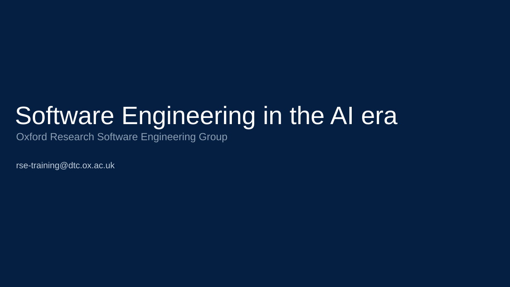

# Software Engineering in the AI Era

**Software Engineering in the AI Era** is a hands-on course exploring how software engineering can help researchers make the most of AI-assisted development.

Using a small research software project, participants will work with AI coding agents to design, build, test and improve software. Along the way, they will learn essential practices for managing dependencies, tracking changes and collaborating with others.

The course emphasises how to steer AI-assisted development through clear requirements, thoughtful design and effective testing, so that researchers can make use of increasingly capable coding agents while understanding and evaluating the software they produce.

[View the slides](https://OxfordRSE.github.io/softeng-ai-daycourse/)

## Course materials

Slides:
- [Presentation slides](https://blog.oxrse.uk/softeng-ai-daycourse/)

Project repositories:
- [Susceptible-Infected-Recovered (SIR) Model ](https://github.com/OxfordRSE/softeng-ai-daycourse-sir-model)
