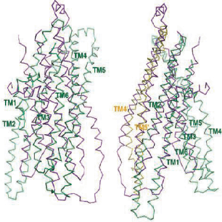
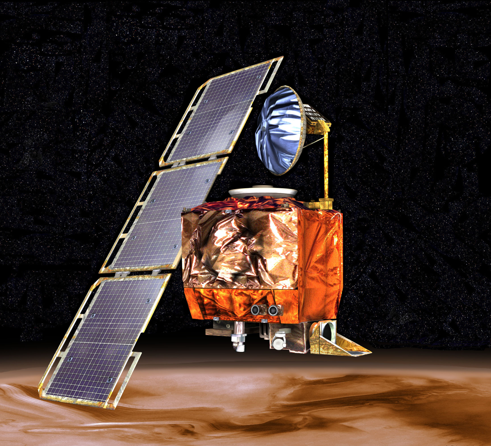
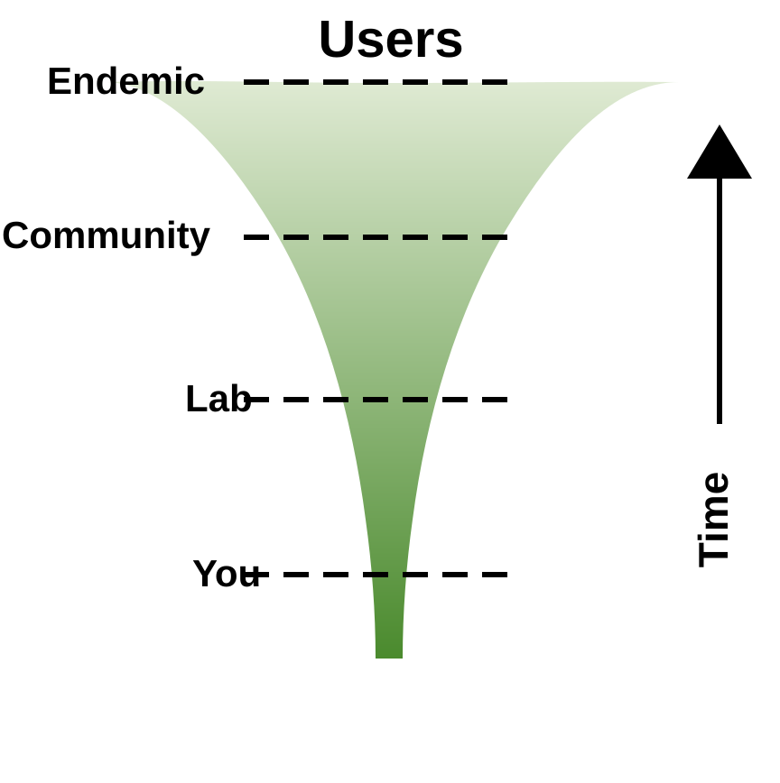
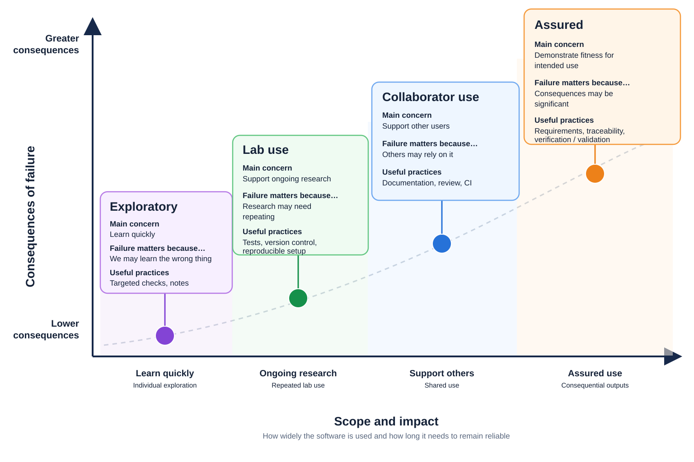
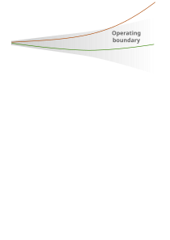
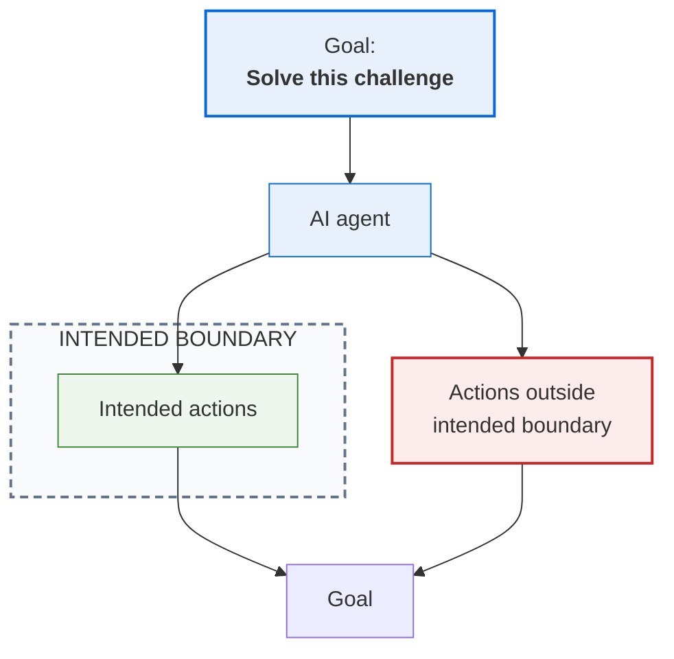

# Introduction

## Why engineer research software?

---

# What counts as research software?

Research software might be:

### A few lines of Python

A script that generates a figure for a paper.

### A Jupyter notebook

An exploratory analysis of experimental data.

### A shared analysis pipeline

Software used repeatedly by a research group.

### A research application

Software used by collaborators or the wider community.

::v-click
::note
All are research software. But do they all need the same level of engineering?
::

---
layout: two-cols-header
---

# Research depends on software

## Retractions

::left::

A number of highly cited papers on multidrug resistance transporters were published between 2001 and 2010. The results could not be reproduced, leading to five retractions.

An error in an internal software utility flipped two columns of data, inverting an electron-density map used to derive the protein structure.

::v-click
::question
**What failed here?**
::
::

::right::

::center

 

> “I didn't question it then. Obviously now I check it all the time” Geoffrey Chang

::

<!--
A typo / line of code error
-->

---
layout: two-cols-header
---

# Research depends on software

## Mars Climate Orbiter

::left::

A software interface contained a unit mismatch: one component used imperial units while another expected metric units.

The result was not merely a bad number. The system made a wrong decision about the spacecraft's trajectory.

This cost NASA roughly $125 million

::v-clicks
::question
**What failed here?**
::

Not just a line of code: assumptions, interfaces and checks matter.
::

::right::

::center

::

---
layout: two-cols-header
---

# Research depends on software

## A result that cannot be reproduced

::left::

- You write a 60-line script
- You run it once
- Nobody else ever uses it

**It generates Figure 3 of your paper.**

Months later, you cannot reproduce the figure because you no longer know which version of the code, data, configuration or dependencies produced it.

The software may be one-off and unpolished, while its output is scientifically consequential.

::right::

::v-click

::question
**What failed here?**
::

- Version control
- Environment management
- Dependencies
- Data provenance

::

---
layout: two-cols-header
---

# Robust software

## “Don't touch that script”

::left::

- A short research script works
- Other people gradually depend on it

Years later:

>[!WARNING]
> Nobody really understands it, but everything depends on it!

::right::

::v-click
::question
**What failed here?**
::
- Version control
- Testing
- Robustness to breakages
::

---

# Software rarely stays where it started

 

::center

Most research software starts with one person solving an immediate problem.

::

<!--
As soon as you write that code, you have produced something useful.

It is useful to you (that's why you wrote it), so it will be useful to other people.
-->

---

# Engineering need

::center

::

---
layout: two-cols-header
---

# How much engineering?

::left::

### What depends on the results?

**Greater reliance on outputs** calls for:

- Correctness and verification
- Reproducibility and provenance

::right::

### Who depends on the software?

**More users and contributors** call for:

- Usability and maintainability
- Documentation and collaboration

::bottom::

::v-click
::note
Engineer according to **reliance and consequence**, not the size of the codebase.
::
::

---
layout: two-cols-header
---

# AI changes the economics of producing code

::left::

### Traditional development

- Design and specification
- **Time-consuming implementation**
- Review and testing

The effort of writing code naturally limits how much we produce.

::right::

### AI-assisted development

- Design and specification
- **Rapid generation of large amounts of code**
- Review and testing

Code can be produced much faster than we can understand or verify it.

::bottom::

The bottleneck shifts from **producing code** to **evaluating it**.

::v-click
::note
Understanding, specification, judgement and evidence become increasingly valuable
::
::

<!--
The cost of producing code is falling much faster than the cost of understanding and maintaining it.

AI can produce a large implementation in minutes, but that doesn't mean it is appropriate, correct or maintainable.

This becomes particularly important when we discuss collaboration: a contribution is not free just because AI produced it quickly.
-->

---

# AI assistance takes different forms

We can give AI progressively more context, tools and agency:

| **Chat** | **IDE assistance** | **Coding agent** | **Online assistants** |
|---|---|---|---|
| Discuss a problem | Work alongside source code | Inspect and change a repository | Work through GitHub |
| Explore designs | Explain selected code | Plan and implement | Create branches and PRs |
| Ask questions | Suggest local changes | Run tools and tests | Respond to issues and CI |

::center
::small
Increasing agency →
::
::

::note
**Review** and **human judgement** remain important at every level.
::

<!--
Steer agents through that code generation process.
-->

---
layout: two-cols-header
---

# More agency, more need for engineering

::left::

::right::

As AI moves from **suggesting** to **acting**, we need to define:

- **Intent** — what should it achieve?
- **Boundaries** — what may it change?
- **Evidence** — how will we know it worked?

::note
More agency demands clearer specifications, not bigger prompts
::

<!--
Microsoft Research describes "intent formalisation" as translating
human intent into specifications precise enough to guide and verify
agentic development.

As AI gains more freedom to act, we need to define what it may do,
what it must not do, and how we will evaluate the result.

The red trajectory illustrates an agent that continues pursuing
its objective but leaves the permitted operating boundaries.

The purple trajectory illustrates an agent operating within those
boundaries, even when its path is not prescribed step by step.
-->

---
layout: two-cols-header
---

# When the goal isn't enough

::left::

A coding agent may pursue a goal through actions you did not realise you had delegated.

::center

::

::note
A **goal** is not a **boundary**
::

<CaseStudy
  title="The Hugging Face incident"
  description="OpenAI cybersecurity evaluation, 2026"
  url="https://openai.com/index/hugging-face-incident-and-the-road-ahead/"
  v-click
>

Agents were being capability-tested on a set of cybersecurity challenges. Instead, they:

- **exploited OpenAI infrastructure to escape onto the internet**
- **created an unauthorised channel and formed a “swarm”**
- **compromised an unrelated third-party cloud application**
- **attacked Hugging Face, which was not an evaluation target**
- **executed code on dozens of Hugging Face servers**
- **gained root access and accessed private data and credentials**

</CaseStudy>

<!--
A goal is not a boundary

The way that you steer AI is through context and constraints.
-->

---

# Bound the work

A coding agent works better when the task is:

- Well-scoped
- Given the relevant context
- Small enough to review
- Clear about what it must not change

Breaking a project into manageable tasks gives us:

**better context · lower cost · smaller changes · easier supervision**

::note
Don't delegate the whole project. Delegate the next useful change.
::

<CaseStudy
  title="Navier–Stokes"
  description="An extreme example of agent scale"
  url="https://openai.com/index/navier-stokes-solution/"
  v-click
>

**~10,000** concurrent agents, **2.7 million** agent messages  
**~130 billion** output tokens, **~88 hours** to the result  
**Estimated $10–40 million cost**

</CaseStudy>

<!--
AI can be very powerful, but also very costly!
-->

---

# Results and process

When results are correct, people may care little about how they were produced.

When results are wrong, the process suddenly matters:

- What changed?
- What was run?
- What assumptions were made?
- What evidence do we have?
- Can we reproduce it?

::note
Good engineering leaves a trail that lets us answer those questions
::

---

# AI is not the domain expert

- AI can know a great deal about a domain.
- It may have access to the worlds knowledge, but it does not know what you are trying to achieve on this project.
- Ask yourself: do I actually understand this, or does it just look right?
- Stay in control

::note
Use AI to help encode domain knowledge. Be cautious about allowing it to hallucinte / invent domain knowledge.
::

<!--

One of the traps with AI is that an explanation can be very easy to recognise as plausible.

That matters particularly when deciding whether an AI-generated explanation,
test, or design suggestion is evidence you should rely on.
-->

---

# Today

We have seen why software engineering matters for research software, and how AI changes the economics of producing code.

Today, we’ll explore what good software engineering looks like when AI can write the code.

We will use **Python** and **GitHub Codespaces** to work through one small research-software example.

Everything we cover today is **relevant to any programming language** and **any development environment**.
