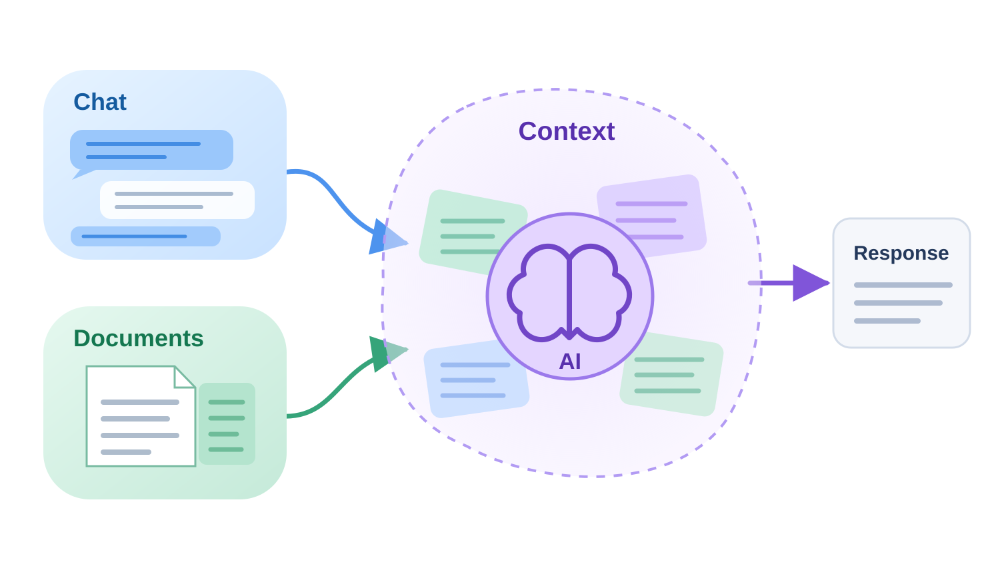

# 1. Software design

## Designing software with AI

---

# Why design before coding?

<span />

::note
In exploratory research, writing software is often part of discovering the requirements.
AI makes implementation faster, but we still need to understand what we're trying to achieve.
::

::v-click

A plausible implementation can still solve the **wrong problem**.

Before asking AI to build something, we need to establish **what you are trying to achieve** and **what the software must do**.

These are related questions, but they are not the same.

::

---

# Motivating problem

<CourseProject>
  <template #sir>

<span />

A research group wants an **interactive dashboard for exploring epidemic models**.

What should the dashboard actually do?

<li>Explore different transmission and recovery rates?</li>
<li>Compare epidemic scenarios?</li>
<li>Introduce vaccination or interventions?</li>
<li>Visualise changes over time?</li>
<li>Export results for further analysis?</li>

  </template>
</CourseProject>

Different researchers could reasonably make different design decisions.

<ProjectSelector />

---
layout: two-cols-header
---

# From an idea to a specification

::left::

**The initial request**

<CourseProject>
  <template #sir>

Build an interactive dashboard for exploring epidemics.

This leaves important questions unanswered:

<li>Who will use it?</li>
<li>Which model should it implement?</li>
<li>Which parameters can users change?</li>
<li>What should the results communicate?</li>

  </template>
</CourseProject>

::right::

::v-click

**A more useful specification**

<CourseProject>
  <template #sir>

The dashboard should:
<li>Use a deterministic SIR model</li>
<li>Allow users to adjust transmission and recovery parameters</li>
<li>Display susceptible, infected and recovered populations over time</li>
<li>Clearly communicate the model's assumptions</li>

  </template>
</CourseProject>

::

::bottom::

::v-click
::note
AI is quick to offer solutions. Use conversation to explore the problem first: question its assumptions, consider alternatives and clarify what you actually need.
::
::

<ProjectSelector />

<!--
Ask for one or two suggested prompts before revealing the specification.

Contrast asking AI to implement the request immediately with asking
it to identify ambiguities, assumptions and missing requirements.

We are not looking for a perfect prompt. The point is to use AI
conversationally to clarify the problem before implementation.

Keep this to approximately one minute.
-->

---
layout: two-cols-header
---

# AI Chat

::left::

A **large language model (LLM)** predicts and generates text from context.

For coding, that context might include:

- Your question
- A design document
- Source code
- Test failures
- Tool output

An LLM can therefore help us **reason about and generate software**, but it does not automatically know our requirements or our research context.

::right::



---

# AI-assisted design

<span />

AI can help us explore a problem before we commit to an implementation.

Start with a **question**, not necessarily a request for code.

Ask AI to:

- Identify missing requirements and assumptions
- Suggest alternative approaches
- Explore trade-offs
- Challenge the proposed design
- Identify what we need to decide ourselves

::note
Use AI to clarify the problem before asking it to implement the solution
::

<!--
Avoid anchoring the conversation too early on your preferred solution.

If you already have an idea, consider first asking AI to explore
alternatives without mentioning it.

You can then introduce your idea and ask AI to compare the options.

This helps avoid turning the conversation into an exercise in
confirming your initial assumptions.
-->

---

# Design documentation

<span />

Record the decisions that matter:

- Purpose / users
- Requirements
- Constraints and domain decisions
- Open questions

A Markdown document such as `DESIGN.md` can preserve agreed requirements, assumptions and constraints as reusable context for humans and coding agents.

When a new conversation or coding-agent task begins, provide the document rather than reconstructing the project from memory or from the code.

::note
For substantial work, a short dated decision log can also preserve what was tried, what was found, and what changed.
::

---

# Practical 1 — Explore the problem

<CourseProject>
  <template #sir>

<span />

A research group wants to develop an interactive dashboard for exploring how an epidemic might develop under different assumptions.

The dashboard will use a simple SIR model.

However, its **requirements, intended users and limitations** have not yet been established.

Your task is to use ChatGPT to explore the design.

::note
The objective is to explore requirements, not to write code.
::

  </template>
</CourseProject>

<ProjectSelector />

---

# Practical 1 — Discuss the design with AI

<CourseProject>
  <template #sir>

<span />

Open [chatgpt.com](https://chatgpt.com) and start a new conversation.

Ask ChatGPT:

```text
I want to design an interactive dashboard for exploring
a simple SIR epidemic model.

Interview me to help establish the requirements.
Ask one question at a time, explain alternatives where
useful, and challenge my assumptions.

Do not write code yet.
```

Discuss the design with AI. Make decisions, ask questions and explore alternatives.

::question
Which decisions require your judgement rather than AI's?
::

  </template>
</CourseProject>

<ProjectSelector />

---

# Practical 1 — Capture your decisions

<span />

Ask ChatGPT:

```text
Summarise our discussion as a concise Markdown design document.

Include requirements, assumptions, constraints and open questions.

Distinguish agreed decisions from suggestions that still need consideration.
```

Review the document:

- Does it accurately represent your decisions?
- Has AI introduced assumptions you didn't agree to?
- What remains unresolved?

::note
A design discussion can become reusable context for future development.
::

---

# From design to implementation

<span />

Not every design question can be answered through discussion.

Sometimes the quickest way to resolve uncertainty is to **build a small prototype**.

A prototype helps us:

- Explore an idea
- Test an assumption
- Discover missing requirements

We've explored different possible designs. For the rest of today, we'll use a **common specification**.
