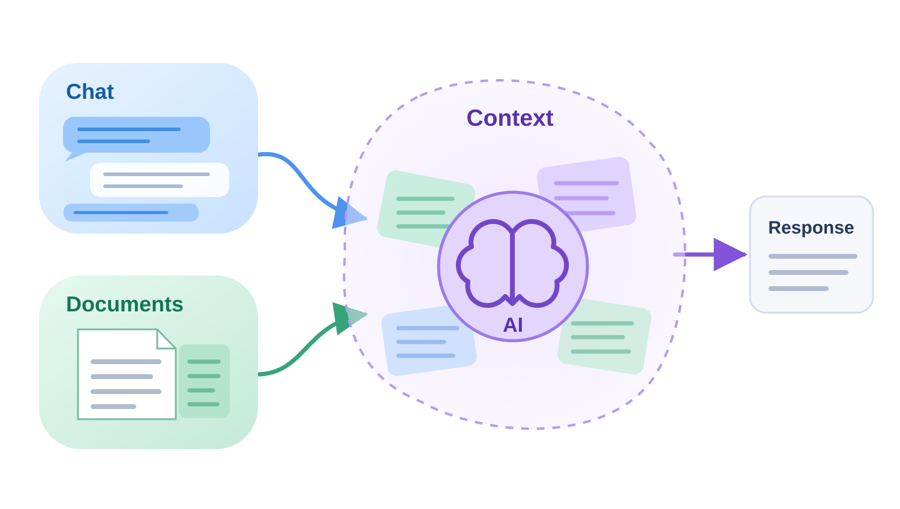
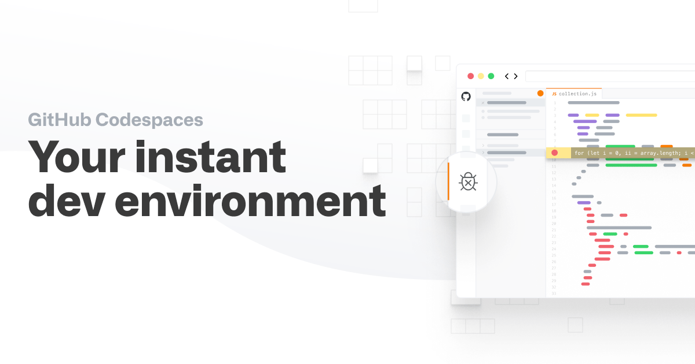

# 1. Software design

## Designing software with AI

---

# Why design before coding?

::note
AI makes it tempting to start coding before we've clarified the problem or given it sufficient context
::

::v-click

A plausible implementation can still solve the **wrong problem**.

Before asking AI to build something, we need to establish **what you are trying to achieve** and **what the software must do**.

These are related questions, but they are not the same.

::

---

# Motivating problem

We want a tool that checks research data before analysis.

What does **“checks the data”** actually mean?

- Values within expected ranges?
- Required observations present?
- Duplicate records?
- Units correct?
- Metadata complete?

Different researchers could very reasonably make very different assumptions.

<!--
Metadata - a description of the data; its not much use having a column of numbers if you dont know what they represent or what units they have been measured in.
-->

---
layout: two-cols-header
---

# From an idea to a specification

::left::

**The initial request**

> I want to check my research data before analysis.

This leaves important questions unanswered:

- What makes an observation invalid?
- Which checks are needed?
- What should happen when a problem is found?

::right::

::v-click

**A more useful specification**

The checker should:

- Identify measurements outside a configurable range
- Report problems without modifying the input data
- Preserve existing behaviour when no limits are supplied

::

::bottom::

::v-click
::note
AI is quick to offer solutions. Use conversation to explore the problem first: question its assumptions, consider alternatives and clarify what you actually need.
::
::

<!--
Ask for one or two suggested prompts before revealing the specification.

Contrast asking AI to implement the request immediately with asking
it to identify ambiguities, assumptions and missing requirements.

We are not looking for a perfect prompt. The point is to use AI
conversationally to clarify the problem before implementation.

Keep this to approximately one minute.
-->

---
layout: two-cols-header
---

# AI Chat

::left::

A **large language model (LLM)** predicts and generates text from context.

For coding, that context might include:

- Your question
- A design document
- Source code
- Test failures
- Tool output

An LLM can therefore help us **reason about and generate software**, but it does not automatically know our requirements or our research context.

::right::

---

# AI-assisted design

AI can help us explore a problem before we commit to an implementation.

Start with a **question**, not necessarily a request for code.

Ask AI to:

- Identify missing requirements and assumptions
- Suggest alternative approaches
- Explore trade-offs
- Challenge the proposed design
- Identify what we need to decide ourselves

::note
Use AI to clarify the problem before asking it to implement the solution
::

<!--
Avoid anchoring the conversation too early on your preferred solution.

If you already have an idea, consider first asking AI to explore
alternatives without mentioning it.

You can then introduce your idea and ask AI to compare the options.

This helps avoid turning the conversation into an exercise in
confirming your initial assumptions.
-->

---

# Design documentation

Record the decisions that matter:

- Purpose / users
- Requirements
- Constraints and domain decisions
- Open questions

A design document preserves decisions as reusable context for humans and AI

When a new conversation or coding-agent task begins, provide the document rather than reconstructing the project from memory or from the code.

::note
For substantial work, a short dated decision log can also preserve what was tried, what was found, and what changed.
::

---

# Codespaces

::center

[github.com/codespaces](https://www.github.com/codespaces) gives everyone a common, pre-configured development environment.

For today, think of the Codespace as the machine on which you are developing.

::

---

# Practical 1 — Open your development environment

We'll use **GitHub Codespaces** as our development computer throughout the day.

1. Open the course **Research Data Checker** repository on GitHub.

::center
[https://github.com/OxfordRSE/softeng-ai-daycourse-data-checker](https://github.com/OxfordRSE/softeng-ai-daycourse-data-checker)
::

2. Click **Fork → Create a new fork**.
3. In your fork, select **Code → Codespaces → Create codespace on main**
3. Wait for VS Code to open in your browser

::note
Everyone has the same development environment, ready to use throughout the course
::

---

# Practical 1 — Research Data Checker brief

A research group receives CSV files containing a single numeric column named `measurement`.

Before analysis, they want to identify potentially problematic values without changing the original data.

The checker currently uses minimum and maximum limits of 0 and 100. They want to be able to supply different limits when running the checker.

---

# Practical 1 — Explore requirements with AI

1. Open `instructor/practical-1-brief.md` in VS Code
2. Open **Chat**, click **+** to include the file as context
3. Ask AI:

    > Before writing code, identify decisions needed for configurable minimum and maximum limits.
    Suggest simple options for each.

4. Discuss with AI. You can make your own decisions or ask AI to suggest options. You can also ask it to challenge your assumptions

5. Ask AI to summarise your decisions

::question
Which decisions required your judgement rather than AI's?
::

---

# Practical 1 — Checkpoint

We've explored the requirements and considered different approaches.

Open `DESIGN.md` file in the repository root.

Compare it with your discussion:

- Which decisions did you reach independently?
- Which requirements had you overlooked?
- Are there any assumptions you would challenge?

::note
A design document preserves agreed decisions as reusable context for future human and AI work
::

---

# From design to implementation

Not every design question can be answered through discussion

Sometimes the quickest way to resolve uncertainty is to **build a small prototype**

A prototype helps us:

- Explore an idea
- Test an assumption
- Discover missing requirements

Prototypes are designed to explore ideas quickly, often without considering long-term structure or maintainability. What works well as a prototype may not be a good foundation for the final software.

::note
Use prototypes to learn about the design, not as a commitment to the final implementation
::
