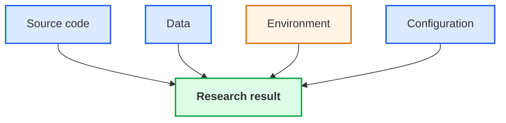
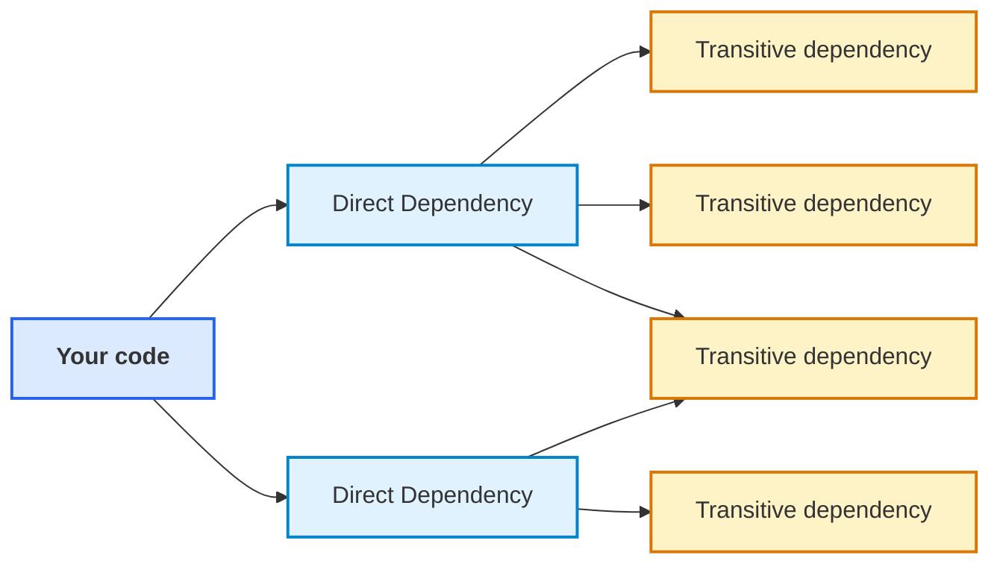
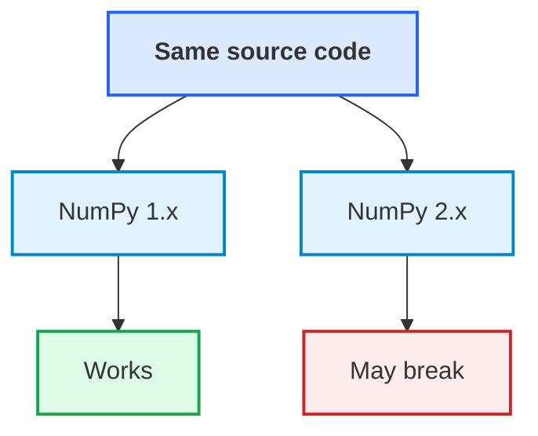

# 3. Environments & dependency management

## Versions, isolation and reproducibility

---

# Reproducing a computation

<span />

To reproduce a result, we need more than the source code.

::center



::

Recording these is an important step towards reproducibility.

Other factors — randomness, hardware and external services — may also matter.

::note
Reproducibility requires knowing what actually ran
::

---
layout: two-cols-header
transition: none
---

# Dependencies are part of the software

::left::

<br />

<div class="w-100 mx-auto">



</div>

::right::

Your code does not run in isolation

The software environment includes your system, and other software packages you have installed

A **dependency** is software your project relies on

::v-clicks

A **direct dependency** is chosen by your project

A **transitive dependency** is required by one of those dependencies

::note
Dependencies introduce **trust**
::

::

---
layout: two-cols-header
---

# Dependencies are part of the software

::left::

<div class="w-100 mx-auto">

<br />


</div>

::right::

Installing a package means running software written and maintained by someone else.

Dependencies can introduce:

- known security vulnerabilities
- malicious or compromised packages
- abandoned or unmaintained software
- further dependencies we did not choose directly

::note
A compromised dependency may access files, secrets, credentials, and network services.
::

---
layout: two-cols-header
---

# Version numbers

::left::

**Numpy versions**

```python
import numpy as np

def main():
    ...
```

::right::

<div class="relative w-3/4 mx-auto mt-4">
  <!-- Vertical timeline -->
  <div class="absolute left-5 top-2 bottom-2 w-1 bg-gray-300"></div>
  <div class="flex flex-col gap-3">
    <!-- NumPy 2.0.2 -->
    <div class="relative flex items-center gap-6">
      <div class="relative z-10 w-11 h-11 bg-white border-2 border-gray-400 rounded-lg flex items-center justify-center text-2xl">
        📦
      </div>
      <div class="flex-1 border border-gray-300 rounded px-6 py-2">
        <div class="text-xl font-bold text-sky-700">2.0.2</div>
        <div class="text-base text-sky-700">Aug 26, 2024</div>
      </div>
    </div>
    <!-- NumPy 2.0.1 -->
    <div class="relative flex items-center gap-6">
      <div class="relative z-10 w-11 h-11 bg-white border-2 border-gray-400 rounded-lg flex items-center justify-center text-2xl">
        📦
      </div>
      <div class="flex-1 border border-gray-300 rounded px-6 py-2">
        <div class="text-xl font-bold text-sky-700">2.0.1</div>
        <div class="text-base text-sky-700">Jul 21, 2024</div>
      </div>
    </div>
    <!-- NumPy 2.0.0 -->
    <div class="relative flex items-center gap-6">
      <div class="relative z-10 w-11 h-11 bg-white border-2 border-gray-400 rounded-lg flex items-center justify-center text-2xl">
        📦
      </div>
      <div class="flex-1 border border-gray-300 rounded px-6 py-2">
        <div class="text-xl font-bold text-sky-700">2.0.0</div>
        <div class="text-base text-sky-700">Jun 16, 2024</div>
      </div>
    </div>
    <!-- NumPy 1.26.4 -->
    <div class="relative flex items-center gap-6">
      <div class="relative z-10 w-11 h-11 bg-white border-2 border-gray-400 rounded-lg flex items-center justify-center text-2xl">
        📦
      </div>
      <div class="flex-1 border border-gray-300 rounded px-6 py-2">
        <div class="text-xl font-bold text-sky-700">1.26.4</div>
        <div class="text-base text-sky-700">Feb 5, 2024</div>
      </div>
    </div>
    <!-- NumPy 1.26.3 -->
    <div class="relative flex items-center gap-6">
      <div class="relative z-10 w-11 h-11 bg-white border-2 border-gray-400 rounded-lg flex items-center justify-center text-2xl">
        📦
      </div>
      <div class="flex-1 border border-gray-300 rounded px-6 py-2">
        <div class="text-xl font-bold text-sky-700">1.26.3</div>
        <div class="text-base text-sky-700">Jan 2, 2024</div>
      </div>
    </div>
  </div>
</div>

<v-click>
  <FancyArrow
    x1="440"
    y1="280"
    x2="530"
    y2="324"
    arc="-0.2"
    head-size="20"
    v-click="1"
  />
</v-click>

---

# Version numbers

<div class="grid grid-cols-[2fr_1fr] gap-x-8 gap-y-10 items-center mt-30">
  <div class="text-center">
    <b>Semantic versioning (SemVer)</b><br>
    <small>API stability, communication, dependency management</small>
  </div>

  <div class="text-center">
    <b>4.3.1</b><br>
    <small>(major.minor.patch)</small>
  </div>

  <div class="text-center">
    <b>Calendar versioning (CalVer)</b><br>
    <small>Regular releases, simplicity</small>
  </div>

  <div class="text-center">
    <b>2025.01</b><br>
    <small>(year.month)</small>
  </div>
</div>

<!--
- Explain major, minor, patch version numbers here
- Explain calendar versioning
- Explain why we would use one over the other

Windows versioning: 1.0, 2.0, 3.0, 3.1, 95, 98, ME, XP, Vista, 7, 8, 8.1, 10, 11

-->

---

# Dependency versions are engineering decisions

<span />

NumPy 2 introduced breaking changes.

The **same source code** can behave differently depending on the installed dependency version.

<div class="w-80 mx-auto mt-8">



</div>

---
layout: two-cols-header
---

# Conflicting requirements need isolation

<span />

Virtual environments, containers and other isolation mechanisms let different projects have different requirements.

Isolation lets environments **coexist**. It does **not** make your code compatible with a dependency's API.

::left::

<div style="background-color: #fef3c7; border: 2px solid #d97706; padding: 1rem; border-radius: 0.5rem;">
<b><u>Project A</u></b>

    Python 3.11
     ├── numpy 1.x
     └── ...
</div>

::right::

<div style="background-color: #fef3c7; border: 2px solid #d97706; padding: 1rem; border-radius: 0.5rem;">
<b><u>Project B</u></b>

    Python 3.12
     ├── numpy 2.x
     └── ...
</div>

::bottom::

::note
Reproduce the software **environment**, not just the source file
::

---
disabled: true
---

# Environments

<div style="position: relative; top: 40px; width: 100%; height: auto; margin: auto;">

  <div class="flex flex-col items-center space-y-1">
    <div class="flex space-x-1">
    <div class="w-40 h-20 border-2 border-yellow-500 text-yellow-500 flex items-center justify-center rounded">Python venv</div>
    </div>
    <div class="flex space-x-1">
      <div class="w-80 h-20 border-2 border-amber-500 text-amber-500 flex items-center justify-center rounded" >conda</div>
    </div>
    <div class="flex space-x-1">
      <div class="w-120 h-20 border-2 border-orange-500 text-orange-500 flex items-center justify-center rounded" >Container</div>
    </div>
    <div class="flex space-x-1">
      <div class="w-160 h-20 border-2 border-red-500 text-red-500 flex items-center justify-center rounded" >Virtual Machine</div>
    </div>
  </div>

</div>

---
layout: two-cols-header
---

# Version constraints communicate intent

::left::

A project can express different compatibility requirements:

```text
numpy == 2.4.3
numpy ~= 2.4
numpy >= 2.1, < 2.6
numpy >= 2
```

The important question is not which syntax you prefer, but **what future change are you prepared to accept?**

Pinning everything forever is not automatically the right answer; neither is accepting every future release.

::right::

We must decide whether to accept **any installed version**, a **compatible range**, or an **exact version**.

::note
The choice balances compatibility, maintenance and reproducibility
::

<CourseLink
  title="Packaging and Dependency Management"
  description="Go further with pyproject.toml, dependency resolution and reproducible packaging."
  url="https://www.rse.ox.ac.uk/training"
  v-click
/>

<!--
numpy ~= 2.4 means 2.4 or later, but not 3.0; equivalent to >= 2.4, < 3.0
-->

---
layout: two-cols-header
---

# When a dependency breaks

::left::

Your research software worked yesterday.

You hand it to a colleague, and they run it in their environment.

```text
ImportError: cannot import name '...' from 'numpy'
```

The source code has not changed.

::question
What has changed, and how should we respond?
::

::right::

Possible explanations include:

- an incompatible dependency version;
- an incomplete dependency specification;
- the wrong Python environment;
- code relying on an API that has changed.

The first task is **diagnosis**, not modification.

---

# Which Python are you using?

<span />

A Python environment determines which interpreter and installed packages your code uses.

```bash
python -m venv .venv          # create an isolated environment
source .venv/bin/activate     # activate it (Windows: .venv\Scripts\activate)
which python                  # confirm the active interpreter
python -m pip install numpy   # install into that environment
python -m pip list            # what is installed
deactivate                    # return to the system environment
```

Two environments can contain different versions of the same package.

```text
Project A                 Project B
    │                          │
Python environment A      Python environment B
    │                          │
NumPy 1.x                 NumPy 2.x
```

::note
Installing a package is not enough — it must be installed in the environment running your code.
::

---

# Practical 3 — Two environments

<span />

The Research Data Checker works with NumPy 1.x.

**Environment A — existing environment**

```bash
python -m research_check.cli examples/observations.csv
```

**Environment B — NumPy 2.x**

```bash
python -m venv .venv2
source .venv2/bin/activate
python -m pip install "numpy>=2"
python -m research_check.cli examples/observations.csv
```

Compare the results and record your observations in `ENVIRONMENT.md`.

::question
**Why does the same source code behave differently?**
::

---

# Practical 3 — Checkpoint

<span />

You have run the **same source code** in two different environments

- One works
- One fails because a dependency API has changed

::question
**Should we restore the original environment or update the code?**
::

There is no universal answer. Consider:

- Reproducing previous results
- Maintaining compatibility
- Supporting future development

::note
Isolation lets environments coexist, it does not resolve incompatibility
::

---

# AI and environments

<span />

AI can help us create and manage environments.

But it needs to know:

- **Which environment** should run the software?
- **Which dependencies** are compatible?
- **What changes** is it allowed to make?
- **What must remain reproducible?**

Project instructions such as `AGENTS.md` can help communicate these expectations

::note
An agent should not silently change the environment to make a problem disappear
::
