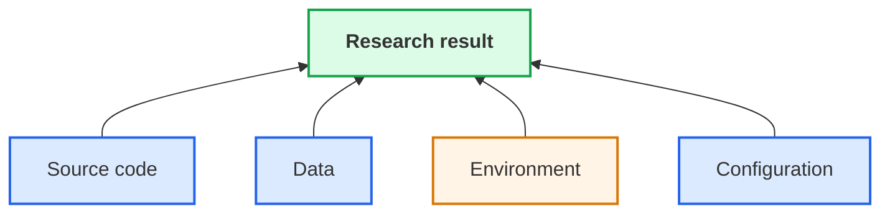
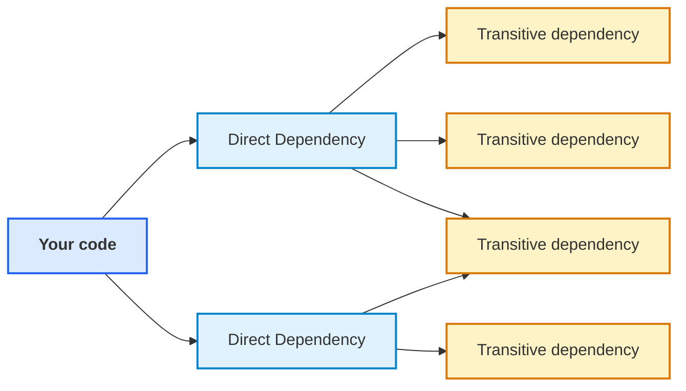
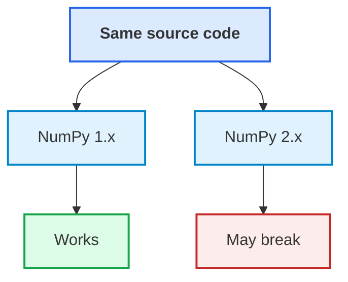
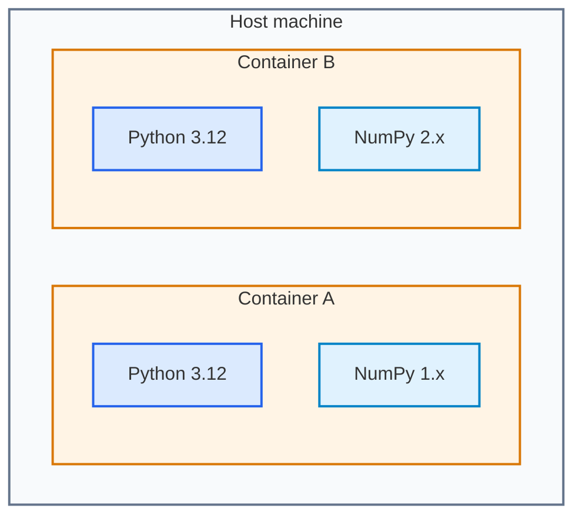

# 3. Environments & dependency management

## Managing dependencies and reproducibility

---

# Reproducing a computation

<span />

To reproduce a result, we need more than the source code.

::center



::

Recording these is an important step towards reproducibility.

Other factors — randomness, hardware and external services — may also matter.

::note
Reproducibility requires knowing what actually ran
::

---
layout: two-cols-header
transition: none
---

# Dependencies are part of the software

::left::

<br />

<div class="w-100 mx-auto">



</div>

::right::

Your code does not run in isolation

The software environment includes your system, and other software packages you have installed

A **dependency** is software your project relies on

- A *direct* dependency is chosen by your project
- A *transitive* dependency is required by one of those dependencies

::v-click

::note
Dependencies require **trust**
::

::

---
layout: two-cols-header
---

# Dependencies are part of the software

::left::

<div class="w-100 mx-auto">

<br />


</div>

::right::

Installing a package means running software written and maintained by someone else.

Dependencies can introduce:

- known security vulnerabilities
- malicious or compromised packages
- abandoned or unmaintained software
- further dependencies we did not choose directly

::note
A compromised dependency may access files, secrets, credentials, and network services.
::

---
layout: two-cols-header
---

# Version numbers

::left::

**Numpy versions**

```python
import numpy as np

def main():
    ...
```

::right::

<div class="relative w-3/4 mx-auto mt-4">
  <!-- Vertical timeline -->
  <div class="absolute left-5 top-2 bottom-2 w-1 bg-gray-300"></div>
  <div class="flex flex-col gap-3">
    <!-- NumPy 2.0.2 -->
    <div class="relative flex items-center gap-6">
      <div class="relative z-10 w-11 h-11 bg-white border-2 border-gray-400 rounded-lg flex items-center justify-center text-2xl">
        📦
      </div>
      <div class="flex-1 border border-gray-300 rounded px-6 py-2">
        <div class="text-xl font-bold text-sky-700">2.0.2</div>
        <div class="text-base text-sky-700">Aug 26, 2024</div>
      </div>
    </div>
    <!-- NumPy 2.0.1 -->
    <div class="relative flex items-center gap-6">
      <div class="relative z-10 w-11 h-11 bg-white border-2 border-gray-400 rounded-lg flex items-center justify-center text-2xl">
        📦
      </div>
      <div class="flex-1 border border-gray-300 rounded px-6 py-2">
        <div class="text-xl font-bold text-sky-700">2.0.1</div>
        <div class="text-base text-sky-700">Jul 21, 2024</div>
      </div>
    </div>
    <!-- NumPy 2.0.0 -->
    <div class="relative flex items-center gap-6">
      <div class="relative z-10 w-11 h-11 bg-white border-2 border-gray-400 rounded-lg flex items-center justify-center text-2xl">
        📦
      </div>
      <div class="flex-1 border border-gray-300 rounded px-6 py-2">
        <div class="text-xl font-bold text-sky-700">2.0.0</div>
        <div class="text-base text-sky-700">Jun 16, 2024</div>
      </div>
    </div>
    <!-- NumPy 1.26.4 -->
    <div class="relative flex items-center gap-6">
      <div class="relative z-10 w-11 h-11 bg-white border-2 border-gray-400 rounded-lg flex items-center justify-center text-2xl">
        📦
      </div>
      <div class="flex-1 border border-gray-300 rounded px-6 py-2">
        <div class="text-xl font-bold text-sky-700">1.26.4</div>
        <div class="text-base text-sky-700">Feb 5, 2024</div>
      </div>
    </div>
    <!-- NumPy 1.26.3 -->
    <div class="relative flex items-center gap-6">
      <div class="relative z-10 w-11 h-11 bg-white border-2 border-gray-400 rounded-lg flex items-center justify-center text-2xl">
        📦
      </div>
      <div class="flex-1 border border-gray-300 rounded px-6 py-2">
        <div class="text-xl font-bold text-sky-700">1.26.3</div>
        <div class="text-base text-sky-700">Jan 2, 2024</div>
      </div>
    </div>
  </div>
</div>

<v-click>
  <FancyArrow
    x1="440"
    y1="280"
    x2="530"
    y2="324"
    arc="-0.2"
    head-size="20"
    v-click="1"
  />
</v-click>

---

# Version numbers

<div class="grid grid-cols-[2fr_1fr] gap-x-8 gap-y-10 items-center mt-30">
  <div class="text-center">
    <b>Semantic versioning (SemVer)</b><br>
    <small>API stability, communication, dependency management</small>
  </div>

  <div class="text-center">
    <b>4.3.1</b><br>
    <small>(major.minor.patch)</small>
  </div>

  <div class="text-center">
    <b>Calendar versioning (CalVer)</b><br>
    <small>Regular releases, simplicity</small>
  </div>

  <div class="text-center">
    <b>2025.01</b><br>
    <small>(year.month)</small>
  </div>
</div>

<!--
- Explain major, minor, patch version numbers here
- Explain calendar versioning
- Explain why we would use one over the other

Windows versioning: 1.0, 2.0, 3.0, 3.1, 95, 98, ME, XP, Vista, 7, 8, 8.1, 10, 11
-->

---

# Dependency versions are engineering decisions

<span />

NumPy 2 introduced breaking changes.

The **same source code** can behave differently depending on the installed dependency version.

<div class="w-80 mx-auto mt-8">



</div>

---
layout: two-cols-header
---

# Conflicting requirements need isolation

<span />

Different projects may require incompatible versions of the same software.

Isolated environments let those requirements coexist, without changing the applications themselves.

::left::

<div style="background-color: #fef3c7; border: 2px solid #d97706; padding: 1rem; border-radius: 0.5rem;">
<b><u>Project A</u></b>

    Python 3.11
     ├── numpy 1.x
     └── ...
</div>

::right::

<div style="background-color: #fef3c7; border: 2px solid #d97706; padding: 1rem; border-radius: 0.5rem;">
<b><u>Project B</u></b>

    Python 3.12
     ├── numpy 2.x
     └── ...
</div>

::bottom::

::note
Reproduce the software **environment**, not just the source file
::

---

# Environments

<div style="position: relative; top: 40px; width: 100%; height: auto; margin: auto;">

  <div class="flex flex-col items-center space-y-1">
    <div class="flex space-x-1">
    <div class="w-40 h-20 border-2 border-yellow-500 text-yellow-500 flex items-center justify-center rounded">venv</div>
    </div>
    <div class="flex space-x-1">
      <div class="w-80 h-20 border-2 border-amber-500 text-amber-500 flex items-center justify-center rounded" v-click>conda</div>
    </div>
    <div class="flex space-x-1">
      <div class="w-120 h-20 border-2 border-orange-500 text-orange-500 flex items-center justify-center rounded" v-click >Container</div>
    </div>
    <div class="flex space-x-1">
      <div class="w-160 h-20 border-2 border-red-500 text-red-500 flex items-center justify-center rounded" v-click >Virtual Machine</div>
    </div>
  </div>

</div>

---
layout: two-cols-header
---

# Version constraints communicate intent

::left::

A project can specify which dependency versions it supports:

```text
numpy == 2.4.3
numpy ~= 2.4
numpy >= 2.1, < 2.6
numpy >= 2
```

These express different trade-offs between **compatibility, maintenance and reproducibility**.

The question is: **what future changes are we prepared to accept?**

::right::

What happens when a dependency introduces a breaking change?

```text
AttributeError: `np.float_` was removed
in the NumPy 2.0 release.
```

The source code hasn't changed, but the environment has.

::question
Should we constrain the dependency version or update the code?
::

::bottom::

<CourseLink
  title="Packaging and Dependency Management"
  description="Go further with pyproject.toml, dependency resolution and reproducible packaging."
  url="https://www.rse.ox.ac.uk/training"
  v-click
/>

---
layout: two-cols-header
---

# What is a container?

::left::

A container provides an **isolated environment** in which to run software.



::right::

Container images package software with its runtime, dependencies
and configuration.

Ready-made images are available for many environments (https://hub.docker.com/):

- **Python** — `python:3.12-slim`
- **R** — `rocker/r-ver`
- **MATLAB** — official MathWorks images

You can also build images for your own software.

::bottom::

::note
Containers share the host operating system, but maintain their own filesystem and installed software
::

<CourseLink
  title="Containerisation with Docker"
  description="Learn how Docker images and containers provide isolated, reproducible environments."
  url="https://www.rse.ox.ac.uk/training"
  v-click
/>

---

# Practical 3 — Two environments

<span />

We will run the **same Python application** with different versions of NumPy.

Create `docker/app.py`:

```python
import numpy as np

print(f"NumPy version: {np.__version__}")
print(np.float_(3.14))
```

Create `docker/requirements.txt`:

```text
numpy>=1.26,<2
```

::note
The source code will remain unchanged throughout the exercise.
::


---
layout: two-cols-header
---

# Practical 3 — Change the environment

::left::

Inspect the supplied docker/Dockerfile. It describes how to build the environment in which our application will run.

From the `docker/` directory:

**1. Build and run with NumPy 1.x**

```bash
docker build -t numpy-demo:v1 .
docker run --rm numpy-demo:v1
```

The application should run successfully.

::right::

**2. Change `requirements.txt`**

```text
numpy>=2,<3
```

**3. Build and run again**

```bash
docker build -t numpy-demo:v2 .
docker run --rm numpy-demo:v2
```

The application now fails because NumPy 2 removed `np.float_`.

::bottom::

::note
**Going further:** You can connect to a container with `docker run -it --rm numpy-demo:v2 bash` to explore the environment. Type `exit` to leave the container.
::

---

# Practical 3 — Checkpoint

<span />

We ran the **same source code** in two different containers.

The environments coexist, but the code is not compatible with both.

::question
**Should we restore the original environment or update the code?**
::

Consider:

- Reproducing previous results
- Maintaining compatibility
- Supporting future development

::note
Isolation preserves environments. Compatibility still requires engineering decisions.
::

---

# AI and environments

<span />

AI can help us create and manage environments.

But it needs to know:

- **Which environment** should run the software?
- **Which dependencies** are compatible?
- **What changes** is it allowed to make?
- **What must remain reproducible?**

Dependency specifications provide **task-relevant context**, reducing the risk of AI generating code for old or incompatible APIs

Project instructions such as `AGENTS.md` can help communicate these expectations

::note
An agent should not silently change the environment to make a problem disappear
::

---

# Containers and AI agents

<span />

AI coding agents can **execute commands, install software and modify files**.

Running an agent inside a container can help limit the consequences of those actions.

- **Isolation:** Separate the agent's execution environment from your computer.
- **Reproducibility:** Provide a known runtime, tools and dependencies.
- **Disposability:** Rebuild or discard the environment after experimentation.

::note
A container is not automatically a secure sandbox — network access, credentials, mounted files and permissions still matter.
::

<!--
We've been using a containerised development environment
through GitHub Codespaces throughout the course.

This gives us a consistent environment and some isolation
from our own computers.

However, agents may still access the network, GitHub credentials,
or other resources made available to the container.

Mention that .devcontainer/devcontainer.json can define the
development environment, but don't go into its syntax.
-->
