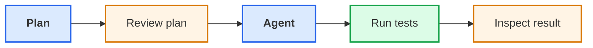

# 4. Software testing

## Tests, regression and quality assurance

---
layout: two-cols-header
---

# Not all errors announce themselves

::left::

Some failures are **loud**:

```text
crash
error
obviously wrong result
```

Others are **silent**:

```text
code runs
result looks reasonable
        ↓
      wrong
```

Research software is especially exposed to silent errors because there may be no known answer to compare with.

::right::

::v-clicks

- Even if your code works initially, how do you know it will continue to work as you change it?
- How do you identify bugs that introduce silent errors?

::

---
layout: two-cols-header
---

# Why test software?

::left::

Automated tests help us to:

- check important behaviour
- find defects earlier
- prevent regressions
- support quality assurance
- gain confidence to change software

The useful question is:

::note
What behaviour do we want to preserve?
::

---
layout: two-cols-header
transition: none
---

# Manual testing

::left::

**Example:** sinc function $f(x) = \frac{\sin(x)}{x}$

```python
# mathlib.py
import math

def sinc(x):
    return math.sin(x) / x
```

::right::

<div style="height: 56px"></div>

::v-clicks
```text
>>> sinc(0.5)
0.958851077208406
```

```text
>>> math.isclose(sinc(0.5), 0.958851077208406)
True
```

```text
>>> math.isclose(sinc(0.5), 0.1)
False
```
::

---
layout: two-cols-header
---

# Manual testing

::left::

**Example:** sinc function $f(x) = \frac{\sin(x)}{x}$

```python
# mathlib.py
import math

def sinc(x):
    return math.sin(x) / x
```

```python
# test_mathlib.py
import math
from mathlib import sinc

def test_sinc():
    assert math.isclose(sinc(0.5), 0.958851077208406)
```

We can now use a testing library (such as `pytest`) to run the test automatically.

::right::

::v-click

Tests provide:
- Confidence that the software is behaving as expected
- A safety net for future changes
- A specification of what the software is supposed to do
- A strong set of constraints to guide AI when it modifies the software

::

::v-click
::note
Build up a suite of tests that capture the behaviour you want to preserve.
::
::

---
layout: two-cols-header
class: "gap-4"
leftClass: "justify-center"
rightClass: "justify-center ml-10"
---

# Code breakdown

::left::

```python {all|1|2-11|12|14-17}
def add3(a, b, c):
    """Add three numbers

    This code adds three numbers together

    Parameters:
        a, b, c: numbers to add

    Returns:
        Sum of three numbers
    """
    ...


def test_add3():
    assert add3(1, 2, 3) == 6
    assert add3(1, 2, None) is None
```

::right::

<v-click at="1">
<h3>Code signature</h3>
<div class="text-sm">How to run the function</div>
<div class="h-5"></div>
</v-click>

<v-click at="2">
<h3>Documentation</h3>
<div class="text-sm">What the function does</div>
<div class="h-5"></div>
</v-click>

<v-click at="3">
<h3>Implementation</h3>
<div class="text-sm">AI can generate this from the test and docs</div>
<div class="h-5"></div>
</v-click>

<v-click at="4">
<h3>Test</h3>
<div class="text-sm">Defines behaviour</div>
</v-click>

---

# A useful test suite

<span />

Tests can operate at different levels:

- **unit** — individual functions / components
- **integration** — interactions between components
- **end-to-end / acceptance** — important user behaviour

For research software, known-answer tests, boundary cases and meaningful properties can be particularly valuable.

---
layout: two-cols-header
transition: none
---

# Test Driven Development

::left::

When a defect is found:
- Reproduce the problem
- Add a failing test
- Fix the implementation
- Keep the test

::note
The bug should only surprise us once
::

::right::

**Example:** sinc function $f(x) = \frac{\sin(x)}{x}$

```python
import math

def sinc(x):
    return math.sin(x) / x
```

::v-click
```text
>>> sinc(0)
ZeroDivisionError: float division by zero
```
::

---
layout: two-cols-header
transition: none
---

# Test Driven Development

::left::

When a defect is found:
- Reproduce the problem
- Add a failing test
- Fix the implementation
- Keep the test

::note
The bug should only surprise us once
::

::right::

**Example:** sinc function $f(x) = \frac{\sin(x)}{x}$

```python
import math

def sinc(x):
    return 1.0
```

```text
>>> sinc(0)
1.0
```

<br />

> [!WARNING]
> If this were the **only** test being run, this solution could be considered correct.

---
layout: two-cols-header
---

# Test Driven Development

::left::

When a defect is found:
- Reproduce the problem
- Add a failing test
- Fix the implementation
- Keep the test

::note
The bug should only surprise us once
::

::note
We are **constraining the implementation space**
::

::right::

**Example:** sinc function $f(x) = \frac{\sin(x)}{x}$

```python
import math

def sinc(x):
    return math.sin(x) / x if x != 0 else 1.0
```

```python
def test_sinc():
    assert math.isclose(sinc(0.5), 0.958851077208406)
    assert math.isclose(sinc(0), 1.0)
```

Tests provide executable expectations that help constrain AI-generated changes.

---

# Practical 4a — Define behaviour with a test

<span />

The Research Data Checker should classify non-finite measurements (`nan`, `inf`, `-inf`) as **invalid**, not out of range.

Open `tests/test_numeric_range.py` and add:

```python
def test_non_finite_measurement_is_invalid():
    rows = [{"measurement": "nan"}]
    issues = check_numeric_range(rows, "measurement", 0.0, 100.0)

    assert len(issues) == 1
    assert issues[0].kind == "invalid"
```

Run:

```bash
pytest
```

::question
**Why does the new test fail?**
::

---

# Working with AI agents

<span />

We've already used AI to explore and modify code.

VS Code Chat offers different ways to work with AI:

- **Ask:** Investigate problems and explain existing code.
- **Plan:** Explore possible changes before implementation.
- **Agent:** Modify files, execute commands and verify results.

The same assistant can support all three workflows.

::note
We can choose when to explore, when to plan and when to let AI enact
::

---

# Plan before implementation

<span />

A useful workflow separates deciding **what to change** from actually changing it.

<div class="w-140 mx-auto mt-8">



</div>

**Plan mode:** Investigate and propose changes without implementing them

**Agent mode:** Implement the agreed changes and run checks

::note
Review the plan before implementation, and inspect the changes afterwards
::

---
layout: two-cols-header
---

# Practical 4b — Implement the behaviour

::left::

You now have a **failing test that defines the required behaviour**.

In VS Code Chat, select **Plan** mode and ask:

::note
Investigate why this test fails. Propose the smallest change needed to satisfy it. Do not modify any files.
::

Review the proposed plan.

**Does it address the requirement without introducing unrelated changes?**

::right::

In the same conversation, switch to **Agent** mode and ask:

::note
Implement the agreed plan. Do not modify the test or `find_duplicates`.
::

Then:

1. Run `pytest`.
2. Confirm the new and existing tests pass.
3. Inspect the changes AI made.

---

# Practical 4 — Checkpoint

```mermaid
flowchart LR
    W["Write test"] --> F["Run → <b>FAIL</b>"]
    F --> P["<b>Plan</b>"]
    P --> R["Review plan"]
    R --> B["<b>Agent</b>"]
    B --> T["Run tests"]
    T --> I["Inspect change"]

    style W fill:#fff4e5,stroke:#d97706,stroke-width:2px
    style F fill:#fdecec,stroke:#c62828,stroke-width:2px
    style P fill:#dbeafe,stroke:#2563eb,stroke-width:2px
    style R fill:#fff4e5,stroke:#d97706,stroke-width:2px
    style B fill:#dbeafe,stroke:#2563eb,stroke-width:2px
    style T fill:#dcfce7,stroke:#16a34a,stroke-width:2px
    style I fill:#fff4e5,stroke:#d97706,stroke-width:2px
```

<span />

<div class="w-180 mx-auto mt-8">



</div>

Discuss:
- How did the failing test constrain what the agent implemented?
- What did you still need to check or decide yourself?

---
layout: two-cols-header
---

# Characterisation tests

::left::

When inheriting unfamiliar software, tests can document **what it currently does** before we change it.

This can make refactoring safer.

AI can be particularly useful here: it can inspect existing code and generate a **test harness that captures current behaviour**, giving us a safety net for subsequent refactoring.

::right::

**Going further**: Ask VS Code Chat to generate characterisation tests for `find_duplicates`. Inspect what behaviour the tests preserve.

::bottom::

::note
Characterisation tests tell us **what the software does**, not whether that behaviour is correct.
::
