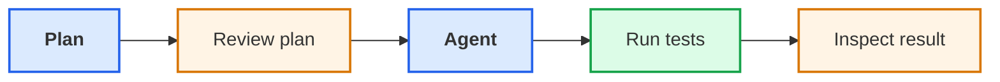

# 4. Software testing

## Defining and verifying expected behaviour

---
layout: two-cols-header
---

# Not all errors announce themselves

::left::

Some failures are **loud**:

```text
crash
error
obviously wrong result
```

Others are **silent**:

```text
code runs
result looks reasonable
        ↓
      wrong
```

Research software is especially exposed to silent errors because there may be no known answer to compare with.

::right::

::v-clicks

- Even if your code works initially, how do you know it will continue to work as you change it?
- How do you identify bugs that introduce silent errors?
- How can we steer AI to make changes that preserve the behaviour we want?

::

---
layout: two-cols-header
---

# Why test software?

::left::

**Manual testing** helps us to:

* Explore how software behaves
* Check that features work as intended
* Discover unexpected problems
* Assess usability and user experience
* Apply human judgement

::right::

**Automated testing** helps us to:

* Codify manual tests into the codebase
* Preserve intended behaviour as code changes
* Detect unintended changes (regressions)
* Check behaviour consistently and repeatedly
* Steer AI-assisted development towards correct behaviour

::bottom::

::note
How do we know our software works as intended?
::

---
layout: two-cols-header
transition: none
---

# Manual testing

::left::

**Example:** sinc function $f(x) = \frac{\sin(x)}{x}$

```python
# mathlib.py
import math

def sinc(x):
    return math.sin(x) / x
```

::right::

<div style="height: 56px"></div>

::v-clicks
```text
>>> sinc(0.5)
0.958851077208406
```

```text
>>> math.isclose(sinc(0.5), 0.958851077208406)
True
```

```text
>>> math.isclose(sinc(0.5), 0.1)
False
```
::

---
layout: two-cols-header
---

# Manual testing

::left::

**Example:** sinc function $f(x) = \frac{\sin(x)}{x}$

```python
# mathlib.py
import math

def sinc(x):
    return math.sin(x) / x
```

```python
# test_mathlib.py
import math
from mathlib import sinc

def test_sinc():
    assert math.isclose(sinc(0.5), 0.958851077208406)
```

We can now use a testing library (such as `pytest`) to run the test automatically.

::right::

::v-click

Tests provide:
- Confidence that the software is behaving as expected
- A safety net for future changes
- A specification of what the software is supposed to do
- A strong set of constraints to guide AI when it modifies the software

::

::v-click
::note
Build up a suite of tests that capture the behaviour you want to preserve.
::
::

---
layout: two-cols-header
class: "gap-4"
leftClass: "justify-center"
rightClass: "justify-center ml-10"
---

# Code breakdown

::left::

```python {all|1|2-11|12|14-17}
def add3(a, b, c):
    """Add three numbers

    This code adds three numbers together

    Parameters:
        a, b, c: numbers to add

    Returns:
        Sum of three numbers
    """
    ...


def test_add3():
    assert add3(1, 2, 3) == 6
    assert add3(1, 2, None) is None
```

::right::

<v-click at="1">
<h3>Code signature</h3>
<div class="text-sm">How to run the function</div>
<div class="h-5"></div>
</v-click>

<v-click at="2">
<h3>Documentation</h3>
<div class="text-sm">What the function does</div>
<div class="h-5"></div>
</v-click>

<v-click at="3">
<h3>Implementation</h3>
<div class="text-sm">AI can generate this from the test and docs</div>
<div class="h-5"></div>
</v-click>

<v-click at="4">
<h3>Test</h3>
<div class="text-sm">Defines behaviour</div>
</v-click>

---

# A useful test suite

<span />

Tests can operate at different levels:

- **unit** — individual functions / components
- **integration** — interactions between components
- **end-to-end / acceptance** — important user behaviour

For research software, known-answer tests, boundary cases and meaningful properties can be particularly valuable.

---
layout: two-cols-header
transition: none
---

# Test Driven Development

::left::

When adding or changing behaviour:
- define the expected result
- write a failing test
- implement the behaviour
- keep the test

::note
Tests make expected behaviour explicit before implementation
::

::right::

**Example:** sinc function $f(x) = \frac{\sin(x)}{x}$

```python
import math

def sinc(x):
    return math.sin(x) / x
```

::v-click
```text
>>> sinc(0)
ZeroDivisionError: float division by zero
```
::

---
layout: two-cols-header
transition: none
---

# Test Driven Development

::left::

When adding or changing behaviour:
- define the expected result
- write a failing test
- implement the behaviour
- keep the test

::note
Tests make expected behaviour explicit before implementation
::

::right::

**Example:** sinc function $f(x) = \frac{\sin(x)}{x}$

```python
import math

def sinc(x):
    return 1.0
```

```text
>>> sinc(0)
1.0
```

<br />

> [!WARNING]
> If this were the **only** test being run, this solution could be considered correct.

---
layout: two-cols-header
---

# Test Driven Development

::left::

When adding or changing behaviour:
- define the expected result
- write a failing test
- implement the behaviour
- keep the test

::note
Tests make expected behaviour explicit before implementation
::

::note
We are **constraining the implementation space**
::

::right::

**Example:** sinc function $f(x) = \frac{\sin(x)}{x}$

```python
import math

def sinc(x):
    return math.sin(x) / x if x != 0 else 1.0
```

```python
def test_sinc():
    assert math.isclose(sinc(0.5), 0.958851077208406)
    assert math.isclose(sinc(0), 1.0)
```

Tests provide executable expectations that help constrain AI-generated changes.

---
layout: two-cols-header
---

# Practical 4a — Test existing behaviour

<CourseProject>
  <template #sir>

<span />

Our SIR simulator models a **closed population**:

$$
S_t + I_t + R_t = N
$$

  </template>
</CourseProject>

::left::

<CourseProject>
  <template #sir>

Create `test_sir.py`:

```python
import pytest
from sir import simulate_sir

def test_population_conservation():
    S, I, R = simulate_sir(1000, 10, 0.3, 0.1, 100)

    for s, i, r in zip(S, I, R):
        assert s + i + r == pytest.approx(1000)
```

  </template>
</CourseProject>

::right::

<CourseProject>
  <template #sir>

Run:

```bash
pip install pytest
pytest
```

  </template>
</CourseProject>

::bottom::

<CourseProject>
  <template #sir>

::question
What does this test establish about our model?
::

  </template>
</CourseProject>

<ProjectSelector />

---
layout: two-cols-header
---

# Practical 4b — Specify new behaviour

<CourseProject>
  <template #sir>

<span />

We want to support **vaccination before the epidemic begins**. Vaccination moves a fraction of the initially susceptible population directly into the recovered compartment.

  </template>
</CourseProject>

::left::

<CourseProject>
  <template #sir>

Add this test to `test_sir.py`:

```python
def test_initial_vaccination():
    S, I, R = simulate_sir(
        population=1000,
        infected=10,
        beta=0.3,
        gamma=0.1,
        days=0,
        vaccination=0.2,
    )

    assert S[0] == pytest.approx(792)
    assert I[0] == pytest.approx(10)
    assert R[0] == pytest.approx(198)
```

  </template>
</CourseProject>

::right::

<CourseProject>
  <template #sir>

Run `pytest` again.

::question
Why does the new test fail?
::

  </template>
</CourseProject>

<ProjectSelector />

---

# Working with AI agents

<span />

We've already used AI to explore and modify code.

VS Code Chat offers different ways to work with AI:

- **Ask:** Investigate problems and explain existing code.
- **Plan:** Explore possible changes before implementation.
- **Agent:** Modify files, execute commands and verify results.

The same assistant can support all three workflows.

::note
We can choose when to explore, when to plan and when to let AI enact
::

---

# Plan before implementation

<span />

A useful workflow separates deciding **what to change** from actually changing it.

<div class="w-200 mx-auto mt-8">



</div>

**Plan mode:** Investigate and propose changes without implementing them

**Agent mode:** Implement the agreed changes and run checks

::note
Review the plan before implementation, and inspect the changes afterwards
::

---
layout: two-cols-header
---

# Practical 4c — Implement the behaviour

::left::

<CourseProject>
  <template #sir>

You now have a **failing test that defines the required behaviour**.

In VS Code Chat, select **Plan** mode and ask:

```text
We want to extend the SIR simulator to support initial vaccination.
Vaccination is an optional fraction between 0 and 1, applied to the initially susceptible population before the simulation begins.
Vaccinated individuals move directly into the recovered compartment, representing immediate and complete protection.
A failing test has already been added.
Inspect the implementation and propose the smallest change needed to satisfy the test while preserving existing behaviour.
Do not modify any files yet.
```

Review the proposed plan.

**Does it address the requirement without introducing unrelated changes?**

  </template>
</CourseProject>

::right::

<CourseProject>
  <template #sir>

In the same conversation, switch to **Agent** mode and ask:

```text
Implement the agreed vaccination change.
Do not modify the tests or the underlying SIR update equations.
Keep the change small and focused.
Run pytest and report the results.
Do not commit or push changes.
```

Then:

1. Run `pytest`.
2. Confirm the new and existing tests pass.
3. Inspect the changes AI made.

  </template>
</CourseProject>

<ProjectSelector />

---

# Going further — Test your simulator

<CourseProject>
  <template #sir>

<span />

Choose a challenge:

- **Regression:** Does zero vaccination preserve the original behaviour?
- **Validation:** Are vaccination values outside 0–1 rejected?
- **Known answer:** Does the first-day update match a hand calculation?
- **Model properties:** Do compartment populations remain non-negative?
- **New feature:** Introduce vaccination on a configurable day.

Use AI to help develop the tests, but decide what behaviour you expect before asking it to implement changes.

  </template>
</CourseProject>

<ProjectSelector />

---

# Practical 4 — Checkpoint

```mermaid
flowchart LR
    W["Write test"] --> F["Run → <b>FAIL</b>"]
    F --> P["<b>Plan</b>"]
    P --> R["Review plan"]
    R --> B["<b>Agent</b>"]
    B --> T["Run tests"]
    T --> I["Inspect change"]

    style W fill:#fff4e5,stroke:#d97706,stroke-width:2px
    style F fill:#fdecec,stroke:#c62828,stroke-width:2px
    style P fill:#dbeafe,stroke:#2563eb,stroke-width:2px
    style R fill:#fff4e5,stroke:#d97706,stroke-width:2px
    style B fill:#dbeafe,stroke:#2563eb,stroke-width:2px
    style T fill:#dcfce7,stroke:#16a34a,stroke-width:2px
    style I fill:#fff4e5,stroke:#d97706,stroke-width:2px
```

<span />

<div class="w-200 mx-auto mt-8">



</div>

Discuss:
- How did the failing test constrain what the agent implemented?
- What did you still need to check or decide yourself?
- What else might we want to test?

---
layout: two-cols-header
---

# Characterisation tests

::left::

When inheriting unfamiliar software, tests can document **what it currently does** before we change it.

This can make refactoring safer.

AI can be particularly useful here: it can inspect existing code and generate a **test harness that captures current behaviour**, giving us a safety net for subsequent refactoring.

::right::

**Going further**: Ask Copilot to generate characterisation tests for the your current code's existing command-line behaviour. Inspect what those tests preserve, and consider whether the behaviour is necessarily correct.

::bottom::

::note
Characterisation tests tell us **what the software does**, not whether that behaviour is correct.
::
