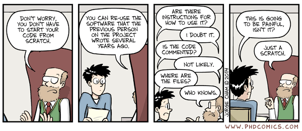
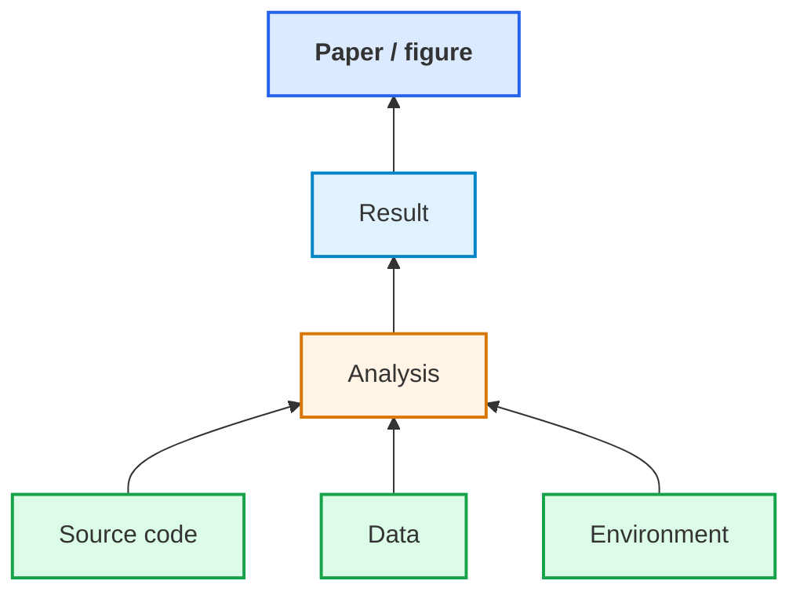
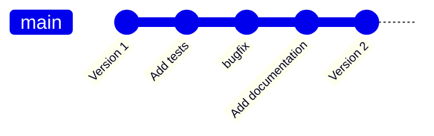
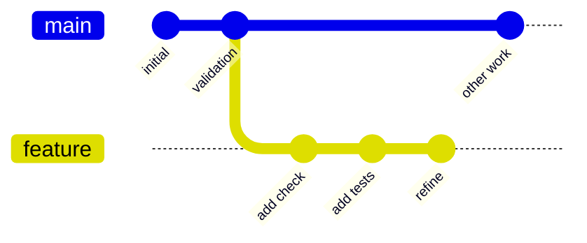
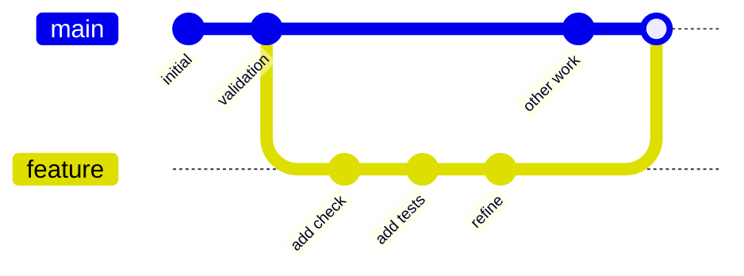

# 5. Version control

## Recording, recovering and combining changes

---

# “Don't touch that bit”

::center



::

Re-running an old script, adjusting a previous student's code, changing code nobody fully understands.

::note
Why are we afraid to change it?
::

---
layout: two-cols-header
---

# Or we make another copy

::left::

```text
analysis.py
analysis_new.py
analysis_v2.py
analysis_v2_fixed.py
analysis_final.py
analysis_final_fixed.py
analysis_final_really_final.py
```

The names are trying to answer questions that version control is designed to answer.

---

# What version produced the result?

::center

<div class="w-120 mx-auto">



</div>

Can we identify the exact state that produced it?
::

---
layout: two-cols-header
transition: none
---

# Repository

::left::

- **Repository** — a collection of files and their history
- **History** — a record of changes to the files, including who made them and when
- **Version control** — a system for managing the repository and its history
- **Git** — a popular version control system
- **Commit** — a snapshot of the repository at a point in time

::right::

Any folder can be turned into a Git repository with `git init`.

A useful commit is:
- coherent
- small enough to understand
- described by an informative message

::bottom::

::center

::

---
layout: two-cols-header
---

# Staging and commits

::centralise::

::left::

<br />

<div style="position: relative; top: 0px; width: 40%; height: auto; margin: auto;">

  <div class="flex flex-col items-center space-y-10">
    <div class="flex space-x-1">
    <div class="w-50 h-15 border-2 border-orange-500 text-orange-500 flex items-center justify-center rounded">Working directory</div>
    </div>
    <div class="flex space-x-1">
      <div class="w-50 h-15 border-2 border-amber-500 text-amber-500 flex items-center justify-center rounded">Staging area</div>
    </div>
    <div class="flex space-x-1">
      <div class="w-50 h-15 border-2 border-yellow-500 text-yellow-500 flex items-center justify-center rounded">Repository</div>
    </div>
  </div>

  <FancyArrow
    x1="154"
    y1="160"
    x2="100"
    y2="205"
    arc="-0.4"
    head-size="15"
  />
  
  <div class="absolute top-16.5 left--30">
    <code>git add</code>
  </div>
  
  <FancyArrow
    x1="100"
    y1="235"
    x2="154"
    y2="270"
    arc="-0.4"
    head-size="15"
  />
  
  <FancyArrow
    x1="360"
    y1="267"
    x2="410"
    y2="302"
    arc="0.4"
    head-size="15"
  />

  <div class="absolute top-41.5 left-50 w-30">
    <code>git commit</code>
  </div>
  
  <FancyArrow
    x1="410"
    y1="340"
    x2="360"
    y2="375"
    arc="0.4"
    head-size="15"
  />
  
</div>

::right::

<div class="h-10" />

- **Staging**: Select changes to include in the next Commit (`git add`)
- **Commit**: Record the staged changes in repository history (`git commit`) with a message describing the changes

---

# Inspect the diff

<span />

Before committing, ask:

::note
What actually changed?
::

```bash
git status
git diff
git diff --staged
```

Especially when an AI agent has made the change:

::note
The AI tells you what it says it did. Git shows what changed.
::

---

# Branches support parallel work

::center



::

A branch gives a change its own history without immediately changing the shared line of development.

For substantial agentic experiments, a branch can provide room to experiment.

```bash
git switch -c feature
```

---

# Merging branches

::center



::

A branch lets us develop changes separately.

**Merging** incorporates committed changes from one branch into another.

```bash
git switch main
git merge feature
```

::note
Branches separate work. Merging brings them together.
::

<!--
Demonstrate a merge using VS Code's Git graph.

If main hasn't changed since the branch was created,
Git can simply move main forward (a fast-forward merge).

More complicated merges may require resolving conflicts.
We'll leave that for further exploration.
-->

---
layout: two-cols-header
---

# Who controls the repository?

::left::

A coding agent can:

- Modify files
- Stage changes
- Create commits
- Create or switch branches
- Restore earlier versions

::right::

We can give our agents clear boundaries through `AGENTS.md`, e.g.:

```text
Modify the working tree.
Do not stage or commit.
Stop when the requested change is complete.
```

::bottom::

::note
The agent proposes and implements changes. We decide what enters the repository history.
::

---
layout: two-cols-header
---

# Practical 5 — Record your changes

::left::

::small

**1. Inspect your working tree**

```bash
git status
git diff
```

Review the changes made during Coding and Testing.

**2. Create a branch**

<CourseProject>
  <template #sir>

```bash
git switch -c sir-development
```

  </template>
</CourseProject>

**3. Stage your changes**

<CourseProject>
  <template #sir>

```bash
git add sir.py tests/ AGENTS.md
git status
git diff --staged
```

  </template>
</CourseProject>

Check that only the intended changes are staged.

::

::right::

::small

**4. Commit your work**

<CourseProject>
  <template #sir>

```bash
git commit -m "Implement and test SIR simulator"
```

  </template>
</CourseProject>

**5. Merge into `main`**

<CourseProject>
  <template #sir>

```bash
git switch main
git merge sir-development
```

  </template>
</CourseProject>

**6. Inspect the history**

```bash
git log --oneline --graph --all
```

::note
Review what you're committing before recording it in the repository history.
::

::

<ProjectSelector />

---
layout: two-cols-header
---

# Practical 5 — Recovering changes

::left::

Git lets us return to a known-good version.

**1. Make a temporary edit**

Open `sir.py` and make a small, unwanted change.

**2. Inspect the change**

```bash
git diff
```

::right::

**3. Discard the edit**

```bash
git restore sir.py
```

**4. Verify**

```bash
git status
```

The unwanted change should be gone.

::bottom::

::note
`git restore` discards uncommitted changes. Use it only when you're sure you don't need them.
::

---
layout: two-cols-header
---

# Practical 5 — Going further

::left::

**Explore your history**

- Use `git log` to inspect earlier commits.
- Use `git show` to inspect the changes introduced by a commit.
- Compare two commits using `git diff`.
- Explore the history using VS Code's Source Control view.

::right::

**Explore branches**

- List branches using `git branch -a`.
- Switch between branches.
- Compare their histories.
- Create a temporary branch and experiment.
- Return to `main` when finished.

::bottom::

::note
Branches let us explore alternatives without immediately changing our main line of development.
::

---

# Practical 5 — Checkpoint

<span />

Can you explain the difference between:

- **Working directory** — changes you are currently making
- **Staging area** — changes selected for the next commit
- **Repository history** — changes recorded in commits
- **Branches** — alternative lines of development
- **Merging** — incorporating changes from one branch into another

::note
Git helps us understand, record and recover changes
::

<CourseLink
  title="Version Control with Git"
  description="Learn how to use Git for version control, including branching, merging, and collaborating on code."
  url="https://www.rse.ox.ac.uk/training"
  v-click
/>
