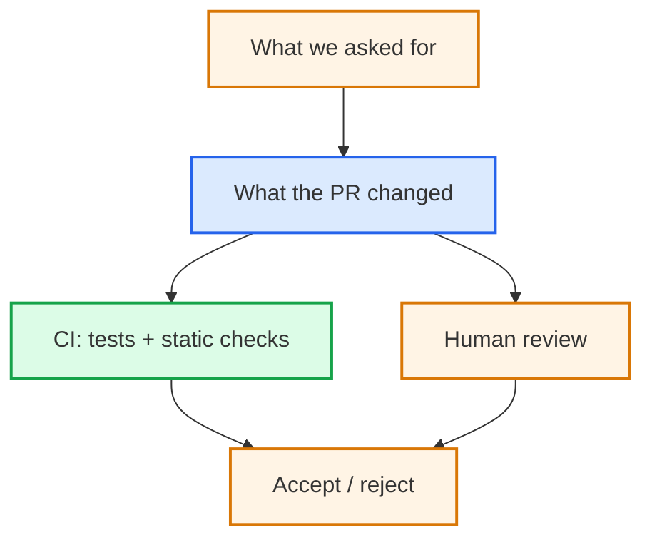

# 6. Collaborative software development

## From individual changes to shared software

---
layout: two-cols-header
---

# A local repository is not enough

::left::

We now have:

- Local repository
  - Working copy of our code
  - Commits, History, Branches
- Linters and auto-formatters
- Test suite

::right::

But **collaborators** have their own copies
- Changes happen independently
- Copies can become out of sync
- Fixes and improvements need to be shared

::bottom::

::note
How do we evolve **one shared codebase**?
::

---
layout: two-cols-header
---

# Software development is ongoing

::left::

Software continues to evolve as people discover:

- Bugs and unexpected behaviour
- New requirements and use cases
- Opportunities for improvement

::right::

When several people contribute, problems need to be:

- **Recorded** somewhere shared
- **Discussed** and prioritised
- **Assigned** and tracked to resolution

::note
**Issue tracking** provides a shared record of problems and proposed changes
::

---
layout: two-cols-header
---

# Move the source of truth

::left::

The remote repository becomes the **agreed single source of truth** for the project

::right::

::center

<div class="pl-4 flex items-center justify-center h-full">
  
</div>

::

---

# GitHub — a guided tour

<span />

We'll explore the Research Data Checker repository together.

- **Code** — files, branches and commit history
- **Issues** — proposed work and discussions
- **Pull requests** — changes proposed for review
- **Actions** — automated checks and workflows

::note
GitHub brings together the tools needed to coordinate software development
::

---

# From individual work to collaboration

<span />

So far, we've been working independently on our own copies of the Research Data Checker

Now we want to **contribute improvements to a shared project**

How can we:

- **Propose** a change before implementing it?
- **Develop** the change without disrupting others?
- **Review** each other's contributions?
- **Decide** what should become part of the shared project?

::note
We'll use GitHub to work through this process together
::

---
layout: two-cols-header
---

# Collaborative code development models

::left::

::center

**Shared repository model**<br />
(common in private projects)


::

::right::

::center

**Fork model**<br />
(common in open source projects)


::

---

# Practical 6a — Publish your work

<span />

You've committed and merged your changes locally. Now let's publish them to GitHub.

1. In your Codespace, check your current branch:

   ```bash
   git status
   ```

2. Push your changes to your fork:

   ```bash
   git push
   ```

3. Open your fork on GitHub and inspect its commit history.

::question
What changed on GitHub?
::

---

# Practical 6b — Your fork and the upstream project

<span />

You've published your changes to your own GitHub repository.

Open the original [Research Data Checker](https://github.com/OxfordRSE/softeng-ai-daycourse-data-checker) repository on GitHub.

- Can you see your commits in the upstream repository?
- Can you see the changes made by other participants?
- Who can merge changes into the upstream repository?

::question
**How can we contribute our work without directly modifying the upstream repository?**
::

---

# Issues — coordinating work

<span />

An issue provides a shared place to discuss a proposed change.

**Instructor demonstration:**

- Open the prepared issue describing the feature we've implemented today
- Identify its interface, boundary and acceptance criteria
- Show how discussion can clarify the task before implementation

---

# Pull requests are gates

<span />

A **pull request** proposes a change to the shared codebase.

Before acceptance we can inspect:

- The issue / requirement
- The diff
- Tests
- Documentation
- Review comments
- Automated checks

The gate can be as light or as formal as the project requires.

<!--
A PR is not just "does this code work?"

Ask: is this a change the project is prepared to own?

Who will maintain it? Is the design understandable? Does it add a dependency or support burden?
-->

---

# Practical 6c — Propose your changes

<span />

You've pushed your course changes to your fork. Now propose them to the **upstream repository**

1. Open your fork on GitHub and select **Contribute → Open pull request**
2. Check the PR direction:
   - **Base:** upstream repository, `main`
   - **Compare:** your fork, `main`
3. Describe the changes you made during the course
4. Inspect **Files changed**
5. Submit the pull request

::question
Is this a focused, reviewable contribution?
::

---

# Continuous Integration

<span />

Earlier, we ran tests ourselves.

**CI runs automated checks when changes are proposed**, in a defined environment.

For a Python project, these might include:

- Installing dependencies
- Running tests
- Checking formatting and linting
- Performing static type checks

The results are reported to contributors and reviewers.

<CourseLink
  title="Continuous Integration"
  description="Continuous integration with GitHub-based workflows."
  url="https://www.rse.ox.ac.uk/training"
  v-click
/>

---
layout: two-cols-header
---

# “It passes on my laptop”

::left::

**Without CI**

::note
“It passes on my laptop.”
::

**With CI**

::note
“The checks pass in a clean environment.”
::

CI makes automated checks repeatable and their results visible to contributors and reviewers.

::right::

::center


::

---
layout: two-cols-header
---

# Code review

::left::

A useful review asks:

- Does this implement the requirement?
- Is the design appropriate?
- Are the tests meaningful?
- Is the change understandable?
- What assumptions have changed?
- What else might this affect?

Review is more than proofreading.

::right::


---

# AI-assisted review

<span />

AI can help to:

- Summarise a diff
- Identify unusual changes
- Suggest missing tests
- Explain unfamiliar code
- Look for consistency problems

But an AI review is **additional input**, not independent approval.

---

# Practical 6d — Review a colleague's PR

<span />

Open another participant's pull request in the upstream repository.

1. Read the description and inspect **Files changed**.
2. Check the CI results.
3. Identify one thing that is clear and one thing that needs clarification.
4. Leave a constructive review comment.

::question
**Would you recommend accepting the contribution? Why?**
::

---
layout: two-cols-header
---

# Who owns the code?

::left::

This AI-assisted contribution to `openfpga-SNES` proposed:

```text
+49,485  -386   ■■■■□
```

The existing repository contains approximately:

```text
38,938 lines of code
```

The proposed addition is larger than the existing codebase.

::v-click
::question
Was this change appropriately scoped?
::
::

::right::

::v-click

Who will:

- Understand it?
- Review and fix bugs?
- Update its dependencies?
- Support its users?
- Change it when requirements evolve?

::note
AI can make code cheap to produce without making it cheap to own.
::
::

<!--
The interesting question is not whether 50,000 lines of code are inherently bad.

Ask: **was this change appropriately scoped?**

Earlier we argued that agentic work should be:
- well-scoped
- given relevant context
- small enough to review
- bounded in what it may change

Here, the proposed addition (~49,500 lines) is larger than the existing
openfpga-SNES codebase (~38,900 lines, measured with cloc).

AI changes the economics of producing code: a contributor can generate a very
large change relatively cheaply.

But that does not make the change easy to understand, review or maintain.

Could the objective have been decomposed into smaller changes?
Could useful intermediate changes have been reviewed independently?
At what point should the maintainer have been involved?

This is the collaborative-development consequence of "bound the work":

**scope work for the people who must understand and review it, not merely for
the agent that can produce it.**

The contributor and maintainer may therefore see the same PR very differently.
-->

---

# Delegate to an agent

<span />

A well-specified **issue** can provide an AI agent with a bounded implementation task:

- **Interface** — what should change?
- **Boundary** — what must remain unchanged?
- **Acceptance** — how will we know it worked?

The agent can implement the change and propose a **pull request**

**CI** provides automated evidence, but **human review** determines whether to accept it

::note
A well-specified problem can enable AI to undertake the development cycle, producing a tested pull request for human review
::

<!--
Before the course, assign the same prepared issue to a coding agent
and retain its resulting pull request.

Participants have now experienced the full development workflow
themselves. Show how the agent can undertake that workflow from
the same issue.

Compare its implementation and CI results with participant PRs.

Ask: Would we accept this contribution? What evidence supports
that decision?

The agent's PR is another proposal for review, not a model answer.
-->

---
layout: two-cols-header
---

# Practical 6 — Checkpoint

::left::



::right::

We've seen how to:

- Define a change through an issue
- Propose an implementation through a PR
- Run automated checks with CI
- Review the proposed changes
- Decide whether to accept the contribution

::note
A pull request is a proposal. Acceptance remains a human decision.
::

::question
What evidence would justify accepting a contribution?
::

---

# Be a helpful contributor

<span />

Before submitting an issue or pull request:

- Search for existing discussions
- Read the contribution guidelines
- Explain what you observed and what you expected
- Provide enough context to reproduce a problem
- Keep proposed changes focused and reviewable
- Respect the time of maintainers and reviewers

::note
AI makes contributions easier to produce. It does not make them free to review
::
