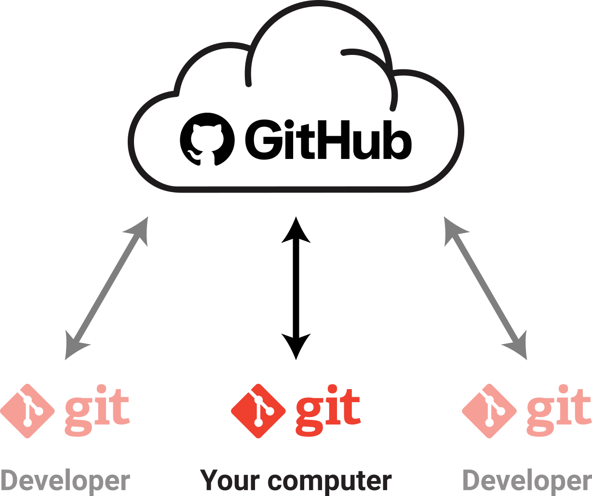
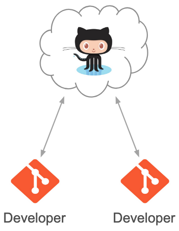
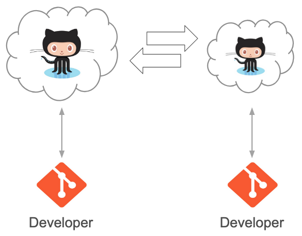
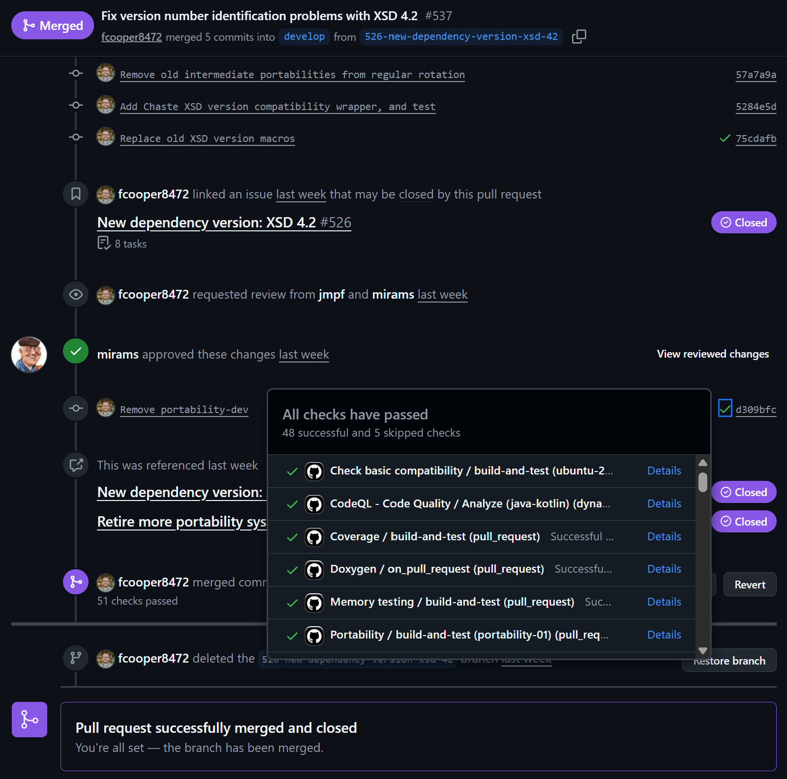
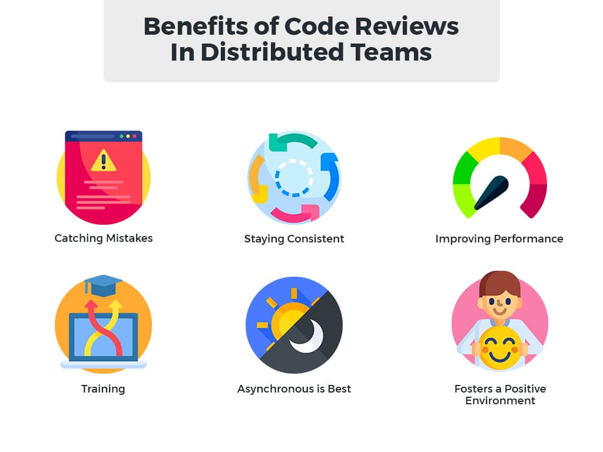
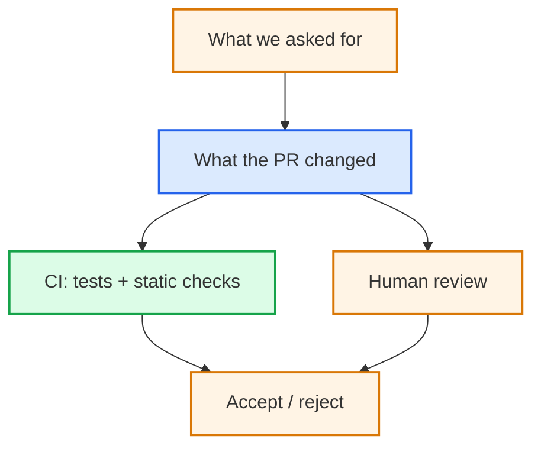

# 6. Collaborative software development

## GitHub, review and continuous integration

---
layout: two-cols-header
---

# A local repository is not enough

::left::

We now have:

- Local repository
  - Working copy of our code
  - Commits, History, Branches
- Linters and auto-formatters
- Test suite

::right::

But collaborators have their own copies.
- Code distribution (multiple computers)
- Multiple variants / out-of-sync copies
- Can variants be merged?

Bug fixes need to be coordinated across these copies

::bottom::

::note
How do we evolve **one shared codebase**?
::

---
layout: two-cols-header
---

# Software development is ongoing

::left::

Software continues to evolve as people discover:

- Bugs and unexpected behaviour
- New requirements and use cases
- Opportunities for improvement

::right::

When several people contribute, problems need to be:

- **Recorded** somewhere shared
- **Discussed** and prioritised
- **Assigned** and tracked to resolution

::note
**Issue tracking** provides a shared record of problems and proposed changes
::

---
layout: two-cols-header
---

# Move the source of truth

::left::

The remote repository becomes the **agreed single source of truth** for the project

::right::

::center

<div class="pl-4 flex items-center justify-center h-full">
  
</div>

::

---

# GitHub — a guided tour

<span />

We'll explore the Research Data Checker repository together.

- **Code** — files, branches and commit history
- **Issues** — proposed work and discussions
- **Pull requests** — changes proposed for review
- **Actions** — automated checks and workflows

::note
GitHub brings together the tools needed to coordinate software development
::

---
layout: two-cols-header
---

# Collaborative code development models

::left::

::center

**Shared repository model**<br />
(common in private projects)



::

::right::

::center

**Fork model**<br />
(common in open source projects)



::

---

# Practical 6a — Fork the repository

<span />

So far, we've worked locally in Codespaces.

Now we'll use GitHub to share and collaborate on software.

1. Open the Research Data Checker repository on GitHub.
2. Click **Fork** and create a copy under your account.
3. Open your fork and explore:
   - **Code** — the files and history
   - **Issues** — problems and proposed improvements
   - **Pull requests** — proposed changes awaiting review

::note
Your Codespace is your development computer. Your fork is a repository you control on GitHub.
::

---

# An issue specifies a bounded change

<span />

A useful feature specification makes three things explicit:

**Interface** — what should exist afterwards?

**Boundary** — what should **not** change?

**Acceptance** — how will we know it works?

::note
A feature request is not yet a specification
::

---

# Practical 6b — Specify a change

<span />

Choose one of the prepared documentation issues in the upstream Research Data Checker repository.

Review its description and identify:

- **Interface** — what should exist afterwards?
- **Boundary** — what must not change?
- **Acceptance** — how will we know the change is complete?

Add a comment suggesting one clarification or acceptance criterion.

::question
Could another contributor implement this without needing to guess?
::

---

# Pull requests are gates

<span />

A **pull request** proposes a change to the shared codebase.

Before acceptance we can inspect:

- The issue / requirement
- The diff
- Tests
- Documentation
- Review comments
- Automated checks

The gate can be as light or as formal as the project requires.

<!--
A PR is not just "does this code work?"

Ask: is this a change the project is prepared to own?

Who will maintain it? Is the design understandable? Does it add a dependency or support burden?
-->

---

# Continuous Integration

<span />

Earlier, we ran tests ourselves.

**CI runs automated checks when changes are proposed**, in a defined environment.

For a Python project, these might include:

- Installing dependencies
- Running tests
- Checking formatting and linting
- Performing static type checks

The results are reported to contributors and reviewers.

<CourseLink
  title="Continuous Integration"
  description="Continuous integration with GitHub-based workflows."
  url="https://www.rse.ox.ac.uk/training"
  v-click
/>

---
layout: two-cols-header
---

# “It passes on my laptop”

::left::

**Without CI**

::note
“It passes on my laptop.”
::

**With CI**

::note
“The checks pass in a clean environment.”
::

CI makes automated checks repeatable and their results visible to contributors and reviewers.

::right::

::center



::

---
layout: two-cols-header
---

# Code review

::left::

A useful review asks:

- Does this implement the requirement?
- Is the design appropriate?
- Are the tests meaningful?
- Is the change understandable?
- What assumptions have changed?
- What else might this affect?

Review is more than proofreading.

::right::



---

# AI-assisted review

<span />

AI can help to:

- Summarise a diff
- Identify unusual changes
- Suggest missing tests
- Explain unfamiliar code
- Look for consistency problems

But an AI review is **additional input**, not independent approval.

---
layout: two-cols-header
---

# Practical 6c — Review a contribution

::left::

Open the prepared pull request using the course link.

1. Read the issue it claims to resolve.
2. Inspect the proposed changes.
3. Check the **boundary** — did anything change outside the requested scope?
4. Check the **acceptance** criteria.
5. Inspect the CI result.

::question
**Would you merge this change? If not, what would you ask the contributor to change?**
::

::right::

**Going further:**

Ask AI to review the pull request.

Did it identify the same concerns as you?

::note
Green CI is not sufficient review
::

---

# Practical 6d — Propose a change

<span />

Return to the issue you specified earlier.

In **your fork on GitHub**:

1. Open the file you want to change.
2. Click the pencil icon to edit it.
3. Make the small documentation improvement.
4. Select **Commit changes**.
5. Choose **Create a new branch for this commit**.
6. Name the branch `documentation-update` and confirm.

::note
Your change is now recorded on a separate branch, ready to propose for review.
::

---

# Practical 6d — Open a pull request

<span />

GitHub may offer **Compare & pull request** after you commit to your new branch.

1. Open a PR from your fork into the **upstream OxfordRSE repository's `main`**.
2. Link the issue and explain your change.
3. Inspect the diff and CI results.
4. Find another participant's PR and review their proposed changes.
5. Respond to any feedback on your own PR.

::question
Would you accept the contribution? What would you ask the author to change?
::

::note
A pull request proposes a contribution. Review and CI provide evidence for the maintainer's decision.
::

---
layout: two-cols-header
---

# Who owns the code?

::left::

This AI-assisted contribution to `openfpga-SNES` proposed:

```text
+49,485  -386   ■■■■□
```

The existing repository contains approximately:

```text
38,938 lines of code
```

The proposed addition is larger than the existing codebase.

::v-click
::question
Was this change appropriately scoped?
::
::

::right::

::v-click

Who will:

- understand it?
- review and fix bugs?
- update its dependencies?
- support its users?
- change it when requirements evolve?

::note
AI can make code cheap to produce without making it cheap to own.
::
::

<!--
The interesting question is not whether 50,000 lines of code are inherently bad.

Ask: **was this change appropriately scoped?**

Earlier we argued that agentic work should be:
- well-scoped
- given relevant context
- small enough to review
- bounded in what it may change

Here, the proposed addition (~49,500 lines) is larger than the existing
openfpga-SNES codebase (~38,900 lines, measured with cloc).

AI changes the economics of producing code: a contributor can generate a very
large change relatively cheaply.

But that does not make the change easy to understand, review or maintain.

Could the objective have been decomposed into smaller changes?
Could useful intermediate changes have been reviewed independently?
At what point should the maintainer have been involved?

This is the collaborative-development consequence of "bound the work":

**scope work for the people who must understand and review it, not merely for
the agent that can produce it.**

The contributor and maintainer may therefore see the same PR very differently.
-->

---

# Practical 6 — Optional: delegate to an agent

<span />

An online coding agent can propose an implementation for an issue.

**Optional demonstration:** assign a small issue to the agent and inspect its pull request against the specification.

::note
Delegation is an option, not a requirement. Human review remains essential.
::

---
layout: two-cols-header
---

# Practical 6 — Checkpoint

::left::



::right::

We have now:

- specified a change;
- inspected a proposed implementation;
- considered tests and CI;
- reviewed the contribution;
- decided whether to accept it.

::question
**What evidence justified your decision?**
::

::note
**A pull request is a proposal. Acceptance remains a human decision.**
::

---

# Be a helpful contributor

<span />

Before submitting an issue or pull request:

- Search for existing discussions.
- Read the contribution guidelines.
- Explain what you observed and what you expected.
- Provide enough context to reproduce a problem.
- Keep proposed changes focused and reviewable.
- Respect the time of maintainers and reviewers.

::note
AI makes contributions easier to produce. It does not make them free to review
::
