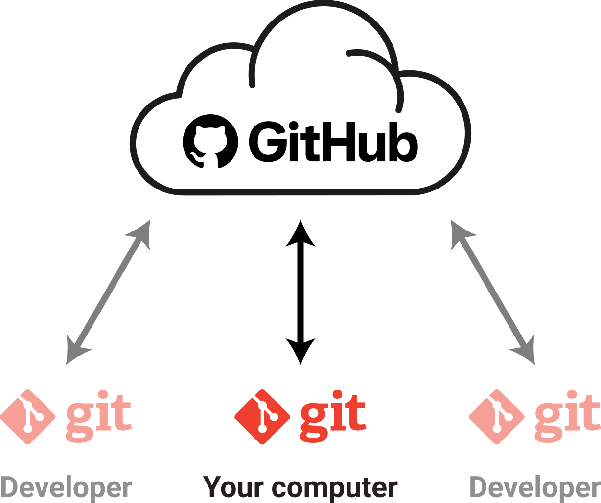
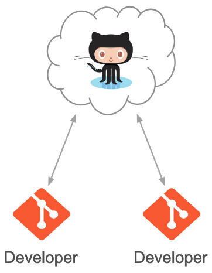
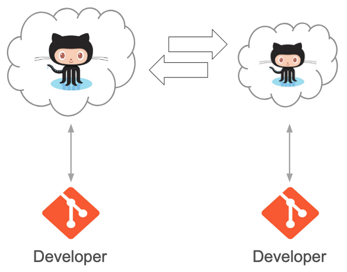
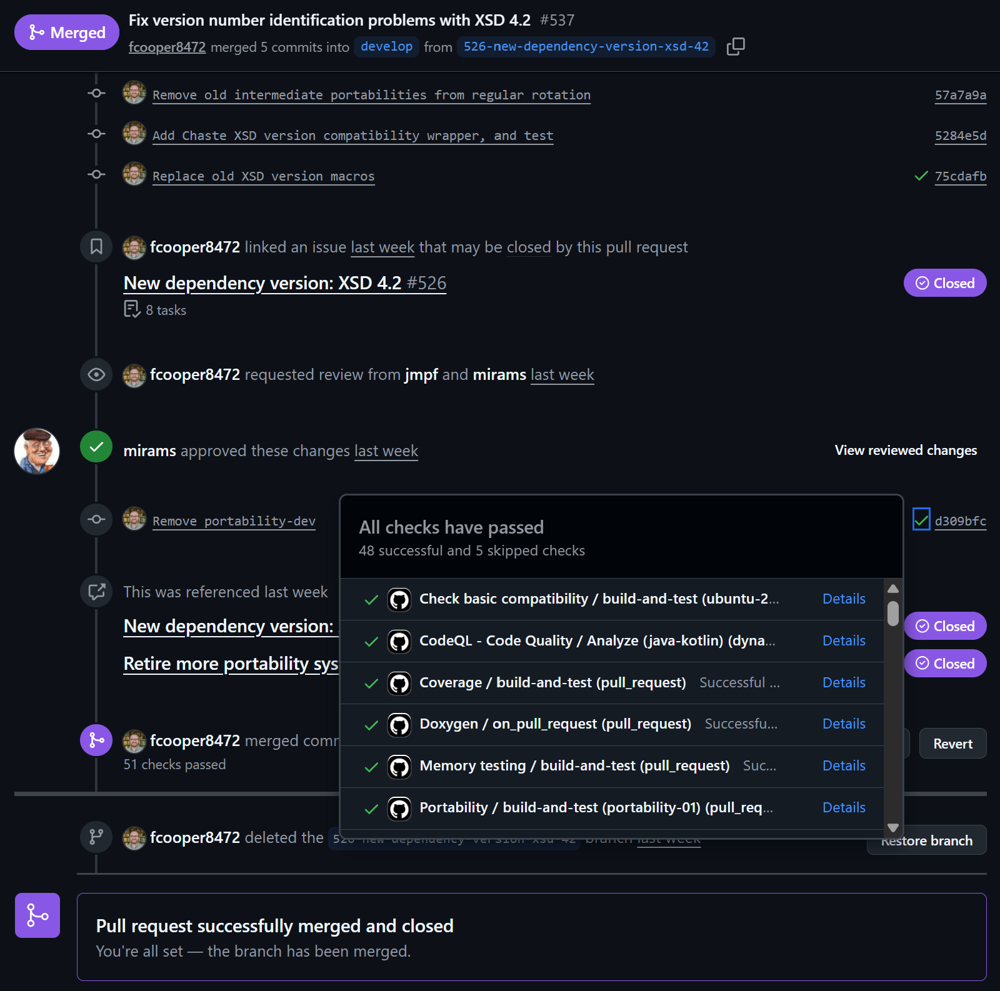
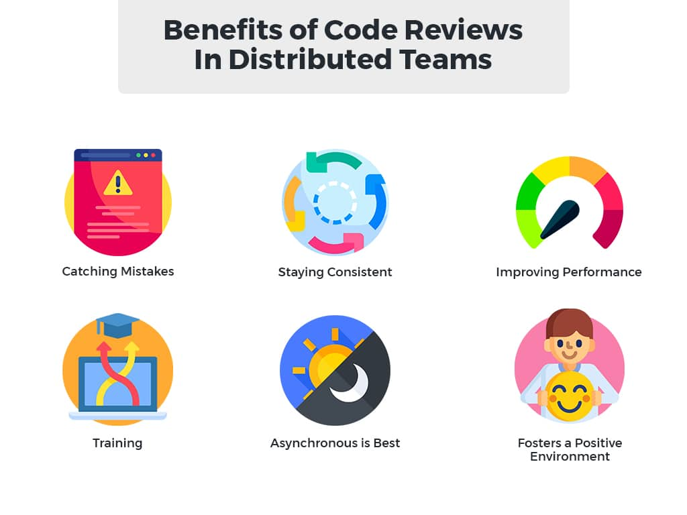
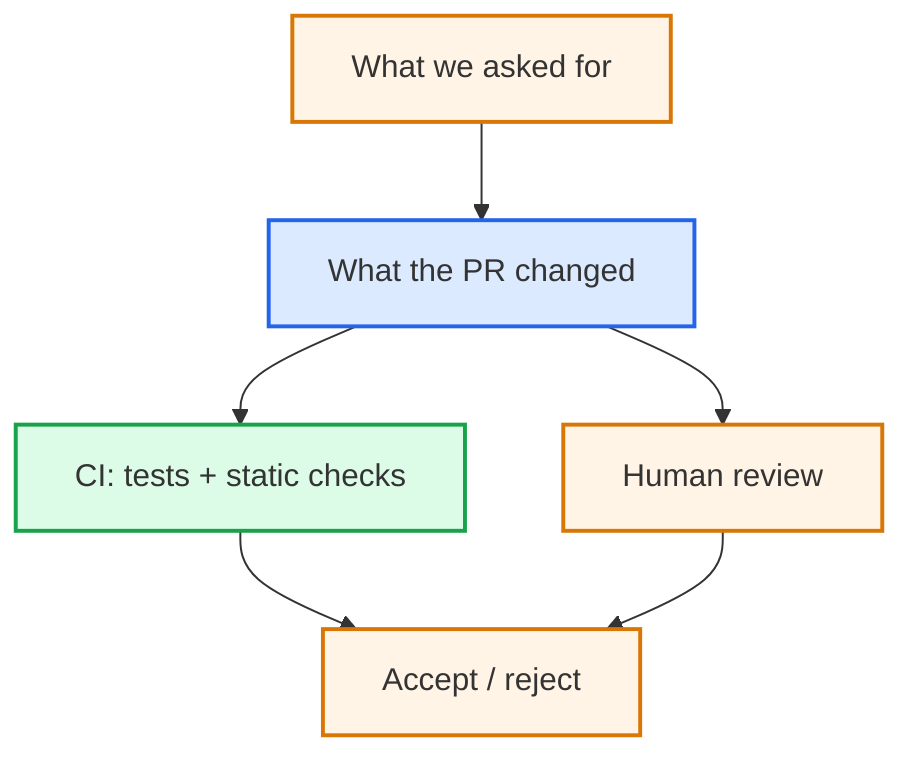

# 6. Collaborative software development

## From individual changes to shared software

---
layout: two-cols-header
---

# A local repository is not enough

::left::

We now have:

- Local repository
  - Working copy of our code
  - Commits, History, Branches
- Linters and auto-formatters
- Test suite

::right::

But **collaborators** have their own copies
- Changes happen independently
- Copies can become out of sync
- Fixes and improvements need to be shared

::bottom::

::note
How do we evolve **one shared codebase**?
::

---
layout: two-cols-header
---

# Software development is ongoing

::left::

Software continues to evolve as people discover:

- Bugs and unexpected behaviour
- New requirements and use cases
- Opportunities for improvement

::right::

When several people contribute, problems need to be:

- **Recorded** somewhere shared
- **Discussed** and prioritised
- **Assigned** and tracked to resolution

::bottom::

::note
**Issue tracking** provides a shared record of problems and proposed changes
::

---
layout: two-cols-header
---

# Move the source of truth

::left::

The remote repository becomes the **agreed single source of truth** for the project

::right::

::center

<div class="pl-4 flex items-center justify-center h-full">
  
</div>

::

---

# GitHub — a guided tour

<span />

We'll explore the repository together.

- **Code** — files, branches and commit history
- **Issues** — proposed work and discussions
- **Pull requests** — changes proposed for review
- **Actions** — automated checks and workflows

::note
GitHub brings together the tools needed to coordinate software development
::

---

# From individual work to shared development

<span />

Now we want to **publish our work and manage proposed changes**.

How can we:

- Share our code and its history?
- Check changes automatically?
- Review changes before accepting them?
- Delegate development tasks to AI agents?

::note
The same practices support collaboration between researchers and supervised AI development.
::

---
layout: two-cols-header
---

# Collaborative code development models

::left::

::center

**Shared repository model**<br />
(common in private projects)



::

::right::

::center

**Fork model**<br />
(common in open source projects)



::

---

# Practical 6a — Publish your work

<span />

You've committed and merged your code and tests locally.

**1. Check your current branch**

```bash
git status
```

**2. Push to GitHub**

```bash
git push
```

**3. Open your repository on GitHub**

Inspect the files and commit history.

::question
What's the difference between a local commit and pushing to GitHub?
::

---

# Issues — coordinating work

<span />

**Instructor demonstration:**

- An issue provides a shared place to discuss a proposed change
- We want to add a feature to our codebase

**Consider:**

- **Interface:** An interactive Streamlit dashboard
- **Boundary:** Reuse the existing model
- **Acceptance:** The interface runs, dependencies are documented, and existing tests pass

::note
A useful issue describes the problem and expected behaviour, not necessarily how to implement it
::

---

# Pull requests are gates

<span />

A **pull request** proposes a change to the shared codebase.

Before acceptance we can inspect:

- The issue / requirement
- The diff
- Tests
- Documentation
- Review comments
- Automated checks

The gate can be as light or as formal as the project requires.

<!--
A PR is not just "does this code work?"

Ask: is this a change the project is prepared to own?

Who will maintain it? Is the design understandable? Does it add a dependency or support burden?
-->

---

# Continuous Integration

<span />

Earlier, we ran tests ourselves.

**CI runs automated checks when changes are proposed**, in a defined environment.

For a Python project, these might include:

- Installing dependencies
- Running tests
- Checking formatting and linting
- Performing static type checks

The results are reported to contributors and reviewers.

::note
Remember isolated environments? GitHub Actions runs our checks in a fresh environment, typically a virtual machine.
::

<CourseLink
  title="Continuous Integration"
  description="Continuous integration with GitHub-based workflows."
  url="https://www.rse.ox.ac.uk/training"
  v-click
/>

---

# Practical 6b — Automate your checks

<span />

Open your repository on GitHub.

1. Select **Actions** → **New workflow**.
2. Choose the **Python Application** workflow template.
3. Inspect the generated workflow:
   - When does it run?
   - Which Python versions does it test?
   - Which commands does it execute?
4. Adjust the Python versions to match your project.
5. Commit the workflow and inspect the results under **Actions**.

::question
What evidence does a successful workflow provide?
::

---
layout: two-cols-header
---

# “It passes on my laptop”

::left::

**Without CI**

::note
“It passes on my laptop.”
::

**With CI**

::note
“The checks pass in a clean environment.”
::

CI makes automated checks repeatable and their results visible to contributors and reviewers.

::right::

::center



::

---
layout: two-cols-header
---

# Code review

::left::

A useful review asks:

- Does this implement the requirement?
- Is the design appropriate?
- Are the tests meaningful?
- Is the change understandable?
- What assumptions have changed?
- What else might this affect?

Review is more than proofreading.

::right::



---

# AI-assisted review

<span />

AI can help to:

- Summarise a diff
- Identify unusual changes
- Suggest missing tests
- Explain unfamiliar code
- Look for consistency problems

But an AI review is **additional input**, not independent approval.

---
layout: two-cols-header
---

# Who owns the code?

::left::

This AI-assisted contribution to `openfpga-SNES` proposed:

```text
+49,485  -386   ■■■■□
```

The existing repository contains approximately:

```text
38,938 lines of code
```

The proposed addition is larger than the existing codebase.

::v-click
::question
Was this change appropriately scoped?
::
::

::right::

::v-click

Who will:

- Understand it?
- Review and fix bugs?
- Update its dependencies?
- Support its users?
- Change it when requirements evolve?

::note
AI can make code cheap to produce without making it cheap to own
::
::

<!--
The interesting question is not whether 50,000 lines of code are inherently bad.

Ask: **was this change appropriately scoped?**

Earlier we argued that agentic work should be:
- well-scoped
- given relevant context
- small enough to review
- bounded in what it may change

Here, the proposed addition (~49,500 lines) is larger than the existing
openfpga-SNES codebase (~38,900 lines, measured with cloc).

AI changes the economics of producing code: a contributor can generate a very
large change relatively cheaply.

But that does not make the change easy to understand, review or maintain.

Could the objective have been decomposed into smaller changes?
Could useful intermediate changes have been reviewed independently?
At what point should the maintainer have been involved?

This is the collaborative-development consequence of "bound the work":

**scope work for the people who must understand and review it, not merely for
the agent that can produce it.**

The contributor and maintainer may therefore see the same PR very differently.
-->

---

# Delegate to an agent

<span />

We've learned how to:

- Specify requirements
- Implement and inspect changes
- Manage dependencies
- Write tests
- Use Git and GitHub
- Run automated checks

Now we can delegate a larger task

::note
An agent can use these tools to implement a feature and propose a tested pull request for review
::

---

# Practical 6c — Delegate using Copilot CLI

<span />

<CourseProject>
  <template #sir>

**1. Start Copilot CLI**

```bash
copilot
```

**2. Delegate the task**

Switch to `Agent` mode and provide the prompt:

```text
Implement a Streamlit dashboard for the SIR simulator in a new file named `app.py`.
Reuse the existing `simulate_sir()` function. Do not duplicate or modify the numerical model.
Allow users to adjust the simulation parameters and visualise the susceptible, infected and recovered populations over time.
Record dependencies in `requirements.txt` and update `README.md` with instructions for running the application.
Create a feature branch, commit and push the changes, and open a pull request against `main` in this repository.
Run the existing checks and report the results.

Do not merge the pull request.
```

  </template>
</CourseProject>

::note
The agent can implement the feature, but we decide whether to accept it.
::

<ProjectSelector />

---

# Practical 6d — Review the agent's PR

<span />

Open the pull request proposed by your coding agent.

**Inspect:**

1. **Files changed** — does the diff implement the requirement?
2. **Dependencies** — are new packages recorded?
3. **Documentation** — can someone else run the dashboard?
4. **Checks** — do the existing tests and CI pass?
5. **Scope** — did the agent change anything unrelated?

::question
Would you accept this contribution? What evidence supports your decision?
::

---
layout: two-cols-header
---

# Practical 6e — Run your application!

<span />

Let's see what your coding agent has built.

::left::

**1. Merge the pull request**

On GitHub, select **Merge pull request** after reviewing the changes and checks.

**2. Update your Codespace**

```bash
git switch main
git pull
```

::right::

**3. Install dependencies**

```bash
pip install -r requirements.txt
```

**4. Launch Streamlit**

```bash
streamlit run app.py
```

Open the forwarded port in Codespaces.

::bottom::

<CourseProject>
  <template #sir>

::question
Can you change the parameters and see the epidemic curves respond?
::

  </template>
</CourseProject>

<ProjectSelector />

---
layout: two-cols-header
---

# Practical 6 — Checkpoint

::left::



::right::

We've seen how to:

- Publish a repository on GitHub
- Configure automated checks
- Delegate a feature to an AI agent
- Inspect a proposed pull request
- Decide whether to accept the change

::note
CI provides automated evidence. Human review determines whether the contribution is acceptable.
::

---

# Be a helpful contributor

<span />

Before submitting an issue or pull request:

- Search for existing discussions
- Read the contribution guidelines
- Explain what you observed and what you expected
- Provide enough context to reproduce a problem
- Keep proposed changes focused and reviewable
- Respect the time of maintainers and reviewers

::note
AI makes contributions easier to produce. It does not make them free to review
::
